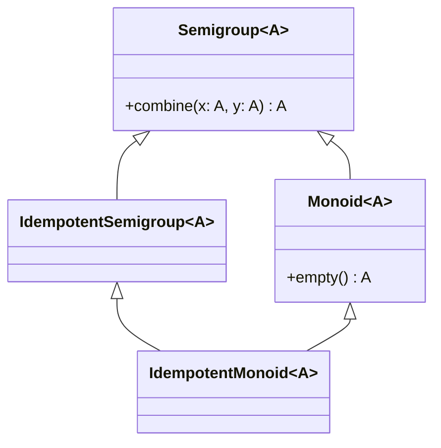



#  Идемпотентный моноид

_IdempotentMonoid_ — это [моноид](monoid.md), 
который также является [идемпотентным](band.md),
т.е. добавление значения к самому себе приводит к тому же значению.

`IdempotentMonoid` должен удовлетворять законам своих "родителей":

- _Замыкание_ (_closure_): для \\(\forall x, y \in IM\\) выполняется \\(x + y \in IM\\).
- _Ассоциативность_ (_associativity_): для \\(\forall x, y, z \in IM\\) выполняется \\((x + y) + z = x + (y + z)\\).
- _Тождественность_ или _существования нейтрального элемента_ (_identity_):
  существует \\(\exists e \in IM\\) такой, что для \\(\forall x \in IM\\) выполняется \\(e + x = x + e = x\\)
- _Идемпотентность_ (_idempotency_): для \\(\forall x \in IM\\) выполняется \\(x + x = x\\).

## Код

```dotty
trait IdempotentMonoid[A] extends Monoid[A], Band[A]
```

### Множества

Некоторые операции над множествами являются идемпотентными: объединение, пересечение и т.п.
Например, объединение множеств образуют `IdempotentMonoid`:

```dotty
given [A]: IdempotentMonoid[Set[A]] with
  def empty: Set[A] = Set.empty[A]
  def combine(x: Set[A], y: Set[A]): Set[A] = x ++ y
```

### Законы

Законы наследуются от [моноида](monoid.md) и [идемпотентной полугруппы](band.md).

## Схема



---

**Ссылки:**

- [Ссылка на репозиторий с упражнениями][sample]

[sample]: https://gitverse.ru/scalabook/typeclasses
