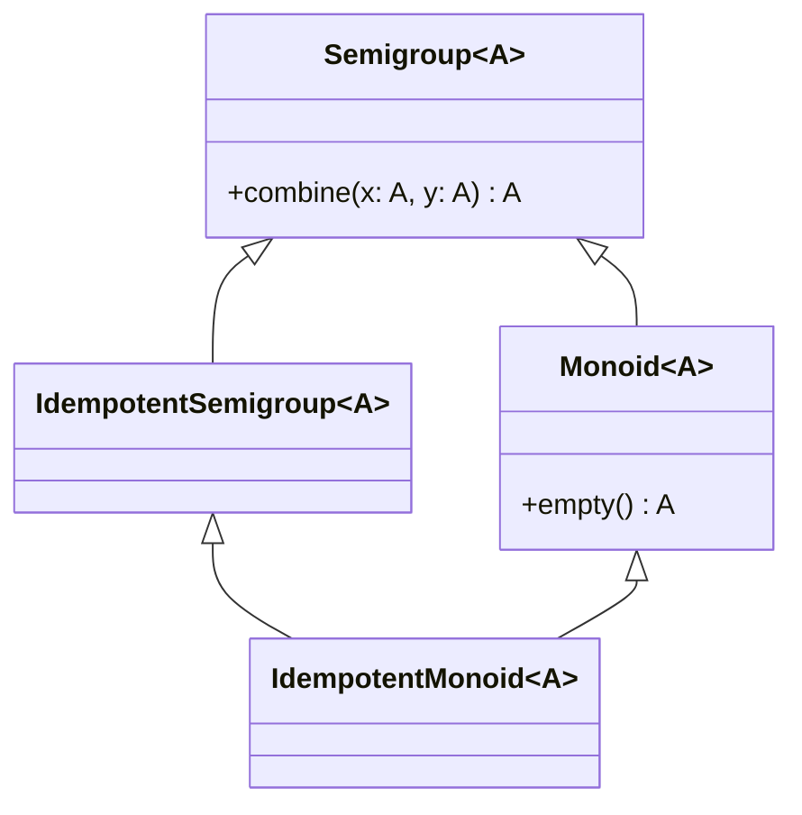



#  Идемпотентный моноид

**Идемпотентный моноид** — это алгебраическая структура, которая сочетает в себе свойства [моноида](monoid.md) и [идемпотентности](band.md). 
Разберем эти понятия по отдельности, а затем объединим их.

а) **Моноид**

Моноид — это множество \\(M\\), на котором определена бинарная операция \\(\cdot\\) (обычно называемая умножением или композицией), 
удовлетворяющая следующим свойствам:

- **Ассоциативность**: для любых \\(a, b, c \in M\\) выполняется \\((a \cdot b) \cdot c = a \cdot (b \cdot c)\\).
- **Наличие нейтрального элемента**: существует элемент \\(e \in M\\) такой, 
  что для любого \\(a \in M\\) выполняется \\(e \cdot a = a \cdot e = a\\).

б) **Идемпотентность**

Элемент \\(a\\) называется идемпотентным, если \\(a \cdot a = a\\). 
Если все элементы моноида идемпотентны, то такой моноид называется **идемпотентным моноидом**.

Таким образом, идемпотентный моноид — это моноид, в котором для любого элемента \\(a\\) выполняется \\(a \cdot a = a\\).

**Примеры идемпотентных моноидов**

- **Булев моноид**:
    - Множество: \\(\{ \text{True}, \text{False} \}\\).
    - Операция: логическое ИЛИ (\\(\lor\\)).
    - Нейтральный элемент: \\(\text{False}\\).
    - Идемпотентность: \\(\text{True} \lor \text{True} = \text{True}\\), \\(\text{False} \lor \text{False} = \text{False}\\).
- **Моноид подмножеств**:
    - Множество: все подмножества некоторого множества \\(S\\).
    - Операция: объединение множеств (\\(\cup\\)).
    - Нейтральный элемент: пустое множество \\(\emptyset\\).
    - Идемпотентность: \\(A \cup A = A\\) для любого подмножества \\(A \subseteq S\\).
- **Моноид проекций**:
    - Множество: проекции в линейной алгебре (операторы, для которых \\(P^2 = P\\)).
    - Операция: композиция операторов.
    - Нейтральный элемент: тождественный оператор.
    - Идемпотентность: \\(P \cdot P = P\\).

**Зачем нужны идемпотентные моноиды?**

Идемпотентные моноиды находят применение в различных областях:

- **Теория языков и автоматов**: используются для моделирования операций над языками.
- **Теория графов**: применяются для анализа путей в графах.
- **Функциональное программирование**: идемпотентные операции полезны для оптимизации вычислений.
- **Базы данных**: идемпотентные операции гарантируют, что повторное выполнение операции не изменит результат.

## Формальное определение

_IdempotentMonoid_ — это [моноид](monoid.md), 
который также является [идемпотентным](band.md),
т.е. добавление значения к самому себе приводит к тому же значению.

`IdempotentMonoid` должен удовлетворять законам своих "родителей":

- _Замыкание_ (_closure_): для \\(\forall x, y \in IM\\) выполняется \\(x + y \in IM\\).
- _Ассоциативность_ (_associativity_): для \\(\forall x, y, z \in IM\\) выполняется \\((x + y) + z = x + (y + z)\\).
- _Тождественность_ или _существования нейтрального элемента_ (_identity_):
  существует \\(\exists e \in IM\\) такой, что для \\(\forall x \in IM\\) выполняется \\(e + x = x + e = x\\)
- _Идемпотентность_ (_idempotency_): для \\(\forall x \in IM\\) выполняется \\(x + x = x\\).

## Код

```dotty
trait IdempotentMonoid[A] extends Monoid[A], Band[A]
```

### Множества

Некоторые операции над множествами являются идемпотентными: объединение, пересечение и т.п.
Например, объединение множеств образуют `IdempotentMonoid`:

```dotty
given [A]: IdempotentMonoid[Set[A]] with
  def empty: Set[A] = Set.empty[A]
  def combine(x: Set[A], y: Set[A]): Set[A] = x ++ y
```

### Законы

Законы наследуются от [моноида](monoid.md) и [идемпотентной полугруппы](band.md).

## Схема



---

**Ссылки:**

- [Ссылка на репозиторий с упражнениями][sample]

[sample]: https://gitverse.ru/scalabook/typeclasses
