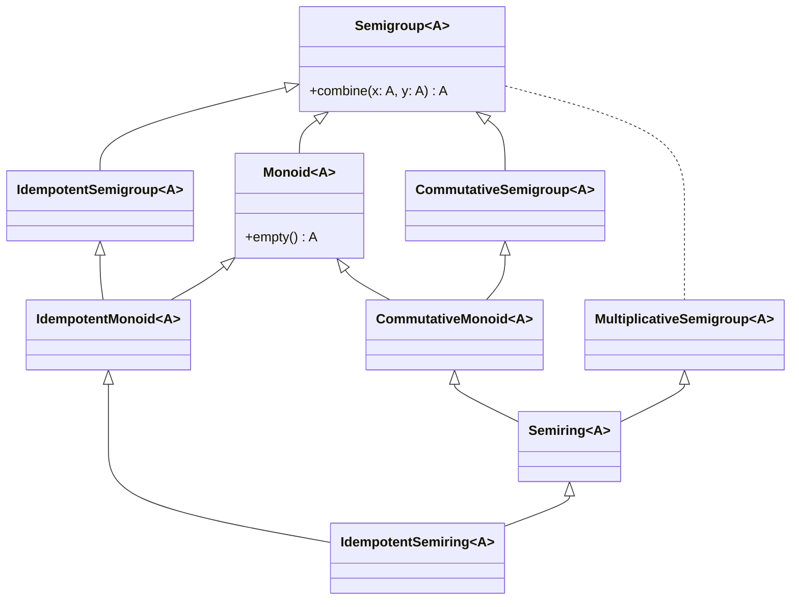

#  Идемпотентное полукольцо

**Идемпотентное полукольцо** — это [полукольцо](semiring.md), в котором операция сложения идемпотентна. 
Это означает, что для любого элемента \\(a\\) из полукольца выполняется свойство \\(a + a = a\\).

**Определение идемпотентного полукольца**

Идемпотентное полукольцо — это множество \\(S\\), на котором определены две бинарные операции:

- **Сложение** (\\(+\\)): идемпотентная, коммутативная и ассоциативная операция.
- **Умножение** (\\(\cdot\\)): ассоциативная операция.

Эти операции должны удовлетворять следующим аксиомам:

- **Идемпотентность сложения**: \\(a + a = a\\) для любого \\(a \in S\\).
- **Коммутативность сложения**: \\(a + b = b + a\\) для любых \\(a, b \in S\\).
- **Ассоциативность сложения**: \\((a + b) + c = a + (b + c)\\) для любых \\(a, b, c \in S\\).
- **Ассоциативность умножения**: \\((a \cdot b) \cdot c = a \cdot (b \cdot c)\\) для любых \\(a, b, c \in S\\).
- **Дистрибутивность умножения относительно сложения**:
    - \\(a \cdot (b + c) = a \cdot b + a \cdot c\\) (левая дистрибутивность),
    - \\((a + b) \cdot c = a \cdot c + b \cdot c\\) (правая дистрибутивность).
- **Наличие нулевого элемента**: существует элемент \\(0 \in S\\) такой, что \\(0 + a = a + 0 = a\\) и \\(a \cdot 0 = 0 \cdot a = 0\\) для любого \\(a \in S\\).

Если в полукольце также существует **единичный элемент** \\(1 \in S\\) такой, 
что \\(a \cdot 1 = 1 \cdot a = a\\) для любого \\(a \in S\\), 
то такое полукольцо называется **идемпотентным полукольцом с единицей**.

**Примеры идемпотентных полуколец**

- **Булево полукольцо**:
    - Множество: \\(\{0, 1\}\\).
    - Операции: логическое ИЛИ (\\(+\\)) и логическое И (\\(\cdot\\)).
    - Идемпотентность: \\(0 + 0 = 0\\), \\(1 + 1 = 1\\).
    - Нулевой элемент: \\(0\\).
    - Единичный элемент: \\(1\\).
- **Тропическое полукольцо**:
    - Множество: \\(\mathbb{R} \cup \{+\infty\}\\).
    - Операции: минимум (\\(+\\)) и сложение (\\(\cdot\\)).
    - Идемпотентность: \\(\min(a, a) = a\\).
    - Нулевой элемент: \\(+\infty\\).
    - Единичный элемент: \\(0\\).
- **Полукольцо подмножеств**:
    - Множество: все подмножества некоторого множества \\(X\\).
    - Операции: объединение (\\(+\\)) и пересечение (\\(\cdot\\)).
    - Идемпотентность: \\(A \cup A = A\\) для любого подмножества \\(A \subseteq X\\).
    - Нулевой элемент: пустое множество \\(\emptyset\\).
    - Единичный элемент: само множество \\(X\\).
- **Полукольцо идемпотентных чисел**:
    - Множество: \\(\{0, 1\}\\).
    - Операции: максимум (\\(+\\)) и умножение (\\(\cdot\\)).
    - Идемпотентность: \\(\max(a, a) = a\\).
    - Нулевой элемент: \\(0\\).
    - Единичный элемент: \\(1\\).

**Зачем нужны идемпотентные полукольца?**

Идемпотентные полукольца находят применение в различных областях:

- **Теория автоматов и формальных языков**: используются для описания и анализа регулярных выражений.
- **Оптимизация**: тропическое полукольцо применяется в задачах оптимизации, таких как поиск кратчайших путей в графах.
- **Компьютерные науки**: используются в алгоритмах, связанных с графами, сетями и логическими операциями.
- **Алгебра**: изучаются как обобщение булевых алгебр и других алгебраических структур.

**Отличие идемпотентного полукольца от обычного полукольца**

Основное отличие заключается в свойстве идемпотентности сложения. 
В идемпотентном полукольце для любого элемента \\(a\\) выполняется \\(a + a = a\\),
тогда как в обычном полукольце это свойство может не выполняться.

## Формальное определение

Идемпотентное полукольцо - это [полукольцо](semiring.md), которое также является [идемпотентным](band.md),
т.е. добавление значения к самому себе приводит к тому же значению.

Для полукольца с единицей должны соблюдаться все законы полукольца:

- _Замыкание сложения_ (_closure_): для \\(\forall x, y \in S\\) выполняется \\(x + y \in S\\).
- _Ассоциативность сложения_ (_associativity_): для \\(\forall x, y, z \in S\\) выполняется \\((x + y) + z = x + (y + z)\\).
- _Существование нулевого элемента_: существует \\(\exists 0 \in S\\) такой,
  что для \\(\forall x \in S\\) выполняется \\(0 + x = x + 0 = x\\)
- _Коммутативность сложения_ (_commutative_): для \\(\forall x, y \in S\\) выполняется \\(x + y = y + x\\).
- _Замыкание умножения_ (_closure_): для \\(\forall x, y \in S\\) выполняется \\(x \* y \in S\\).
- _Ассоциативность умножения_ (_associativity_): для \\(\forall x, y, z \in S\\) выполняется \\((x \* y) \* z = x \* (y \* z)\\).
- _Дистрибутивность_ (_distributivus_, _распределительный закон_):
  для \\(\forall x, y, z \in S\\) выполняется \\(x \* (y + z) = x \* y + x \* z\\) и \\((x + y) \* z = x \* z + y \* z\\).
- _Мультипликативное свойство нуля_: \\(a \* 0 = 0 \* a = 0\\)

, а также закон идемпотентности сложения:

- _Идемпотентность_ (_idempotency_): для \\(\forall x \in S\\) выполняется \\(x + x = x\\).

## Код

```dotty
trait ISemiring[A] extends Semiring[A], IdempotentMonoid[A]
```

### Множества

```dotty
given [A]: ISemiring[Set[A]] with
  val empty: Set[A]                         = Set.empty[A]
  def combine(x: Set[A], y: Set[A]): Set[A] = x ++ y
  def times(x: Set[A], y: Set[A]): Set[A]   = x.intersect(y)
```

### Законы

- Законы [полукольца](semiring.md)
- Идемпотентность формулируется так:  
  `s.combine(x, x)` должно быть равно `x`.  
  Это означает, что объединение элемента с самим собой не изменяет его.

```dotty
... // Законы полукольца

def checkIdempotency[A](x: A)(using s: Band[A]): ValidatedNel[String, Unit] =
  Either.cond[String, Unit](
    s.combine(x, x) == x,
    (),
    "Не соблюдается идемпотентность: x + x должно быть равно x"
  ).toValidatedNel
```

## Схема



---

**Ссылки:**

- [Wikipedia](https://ru.wikipedia.org/wiki/%D0%9F%D0%BE%D0%BB%D1%83%D0%BA%D0%BE%D0%BB%D1%8C%D1%86%D0%BE)
