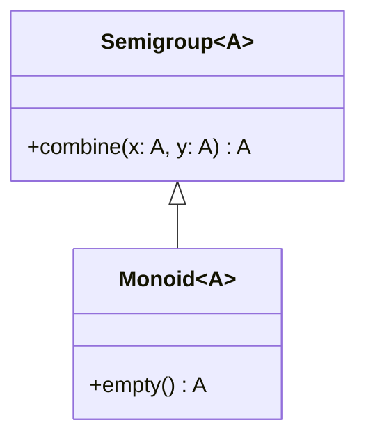



# Моноид

**Моноиды** — это фундаментальная концепция в функциональном программировании, 
которая позволяет абстрагироваться от конкретных типов данных и работать с общими операциями, 
такими как объединение, сложение или конкатенация. 
Эта абстракция не только делает код более универсальным и повторно используемым, 
но и помогает лучше понять принципы композиции данных и функций.

**Что такое моноид?**

Моноид — это математическая структура, которая состоит из:

- **Множества элементов** (например, числа, строки, списки).
- **Бинарной операции** (например, сложение, конкатенация), которая объединяет два элемента множества в один.
- **Нейтрального элемента** (например, 0 для сложения или пустая строка для конкатенации), который не изменяет результат операции.

При этом должны выполняться два ключевых свойства:

- **Ассоциативность**: Результат операции не зависит от порядка вычислений. Например, `(a + b) + c` равно `a + (b + c)`.
- **Нейтральный элемент**: Операция с нейтральным элементом не изменяет значение. Например, `a + 0` равно `a`.

**Зачем нужны моноиды?**

Моноиды играют важную роль в функциональном программировании, так как они позволяют:

- **Абстрагироваться от конкретных типов данных**: Вы можете определить общие операции 
  (например, объединение списков или сложение чисел) независимо от конкретного типа данных.
- **Создавать композируемые функции**: Моноиды позволяют объединять данные в более крупные структуры, 
  что полезно при работе с коллекциями, агрегации данных или параллельной обработке.
- **Упрощать код**: Использование моноидов делает код более декларативным и уменьшает количество шаблонного кода.
- **Работать с параллелизмом**: Ассоциативность моноидов позволяет эффективно разбивать задачи на подзадачи и выполнять их параллельно.

**Примеры моноидов**

- **Числа с операцией сложения**: Множество — числа, операция — сложение, нейтральный элемент — 0.
- **Строки с операцией конкатенации**: Множество — строки, операция — конкатенация, нейтральный элемент — пустая строка.
- **Списки с операцией объединения**: Множество — списки, операция — объединение, нейтральный элемент — пустой список.
- **Булевы значения с операцией "И"**: Множество — булевы значения, операция — логическое "И", нейтральный элемент — `true`.

## Формальное определение

Моноид (_monoid_) — это [полугруппа](semigroup.md) с единичным (нейтральным) элементом.

\\((M, +)\\) является моноидом для заданного множества \\(M\\) и операции \\(+\\),
если удовлетворяет следующим свойствам для любых \\(x, y, z \in M\\):

- _Замыкание_ (_closure_): для \\(\forall x, y \in M\\) выполняется \\(x + y \in M\\).
- _Ассоциативность_ (_associativity_): для \\(\forall x, y, z \in M\\) выполняется \\((x + y) + z = x + (y + z)\\).
- _Тождественность_ или _существования нейтрального элемента_ (_identity_): 
  существует \\(\exists e \in M\\) такой, что для \\(\forall x \in M\\) выполняется \\(e + x = x + e = x\\)

> Первые два закона наследуются от полугруппы.

Также говорится, что _M — моноид относительно +_.

#### Определение из моноидальной категории

Моноид в моноидальной категории — это объект \\(m\\), снабженный двумя морфизмами:

- \\(\mu  : m \bigotimes m \to m\\)
- \\(\eta  : I \to m\\)

удовлетворяющих законам единицы и ассоциативности:

- \\(id\_{m} \bigotimes m = m \bigotimes id\_{m} = m\\)
- \\((m \bigotimes m) \bigotimes m = m \bigotimes (m \bigotimes m)\\)

## Код

```dotty
trait Monoid[A] extends Semigroup[A]:
  def empty: A
```

Для операции сложения встречаются наименования, перечисленные в [полугруппе](semigroup.md):
`combine`, `append`, `mappend` (Haskell), `op`, `plus`, `times`.
Для единичного элемента встречаются следующие наименования: `empty`, `mempty` (Haskell), `id`.

### Законы

- Замыкание следует из определения функции `combine`: тип результата этой функции совпадает с типом переменных,
  которые она принимает.
- Ассоциативность выражается следующим образом:
  `m.combine(x, m.combine(y, z))` должно быть равно `m.combine(m.combine(x, y), z)`.  
  Это означает, что порядок объединения элементов не влияет на итоговый результат.
- Тождественность означает, что если вы объединяете любой элемент `x` с нейтральным элементом (`m.empty`), 
  то результат всегда будет равен `x`. Другими словами, нейтральный элемент не меняет значение `x` при объединении. 
  Это можно записать так:
    - `m.combine(x, m.empty) == x`
    - `m.combine(m.empty, x) == x`

## Упражнения

### Упражнение 1.2.1: Реализация моноида сложения

> [Репозиторий с упражнениями и инструкцией по выполнению][sample]

Ваша задача - заполнив пропущенные части (`???`), реализовать моноид:

- Натуральные числа N относительно сложения

```dotty
given additionMonoid: Monoid[Int] with
  val empty = ???

  def combine(x: Int, y: Int): Int = ???
```

@:note(🔍 Показать решение)

```dotty
given additionMonoid: Monoid[Int] with
  val empty = 0

  def combine(x: Int, y: Int): Int = x + y     
```

**Примеры вызовов**:

```dotty
additionSemigroup.combine(5, 3)
// 8
additionSemigroup.empty
// 0
```

`Int` относительно сложения с `0` образуют моноид, потому что:

- сложение ассоциативно: `(a + b) + c = a + (b + c)`
- `0` - это единичный элемент относительно сложения: `0 + a = a + 0 = a`

@:@

### Упражнение 1.2.2: Реализация моноида умножения

Ваша задача - заполнив пропущенные части (`???`), реализовать моноид:

- Натуральные числа N относительно умножения

```dotty
given multiplicationMonoid: Monoid[Int] with
  val empty = ???

  def combine(x: Int, y: Int): Int = ???
```

@:note(🔍 Показать решение)

```dotty
given multiplicationMonoid: Monoid[Int] with
  val empty = 1

  def combine(x: Int, y: Int): Int = x * y    
```

**Примеры вызовов**:

```dotty
multiplicationMonoid.combine(4, 5) 
// 20
multiplicationMonoid.empty
// 1
```

`Int` относительно умножения с единичным элементом `1` образуют моноид, потому что:

- умножение ассоциативно: `(a * b) * c = a * (b * c)`
- `1` - это единичный элемент относительно сложения: `1*a = a*1 = a`

@:@

### Упражнение 1.2.3: Реализация моноида конкатенации строк

Ваша задача - заполнив пропущенные части (`???`), реализовать моноид:

```dotty
given concatenationMonoid: Monoid[String] with
  val empty = ???
  
  def combine(x: String, y: String): String = ???
```

@:note(🔍 Показать решение)

```dotty
given concatenationMonoid: Monoid[String] with
  val empty = ""
  
  def combine(x: String, y: String): String = x + y   
```

**Примеры вызовов**:

```dotty
concatenationMonoid.combine("Hello, ", "World!")
// "Hello, World!"
concatenationMonoid.empty
// ""
```

`String` относительно конкатенации строк с единичным элементом пустой строкой `""` образуют моноид, потому что:

- конкатенация строк ассоциативна: `(a + b) + c = a + (b + c)`
    - `"мама" + ("мыла" + "раму") =`
    - `("мама" + "мыла") + "раму" =`
    - `"мамамылараму"`
- `""` - это единичный элемент относительно конкатенации: `"" + a = a + "" = a`

@:@

### Упражнение 1.2.4: Реализация моноида для списков

Ваша задача - заполнив пропущенные части (`???`), реализовать моноид:

```dotty
given listMonoid[T]: Monoid[List[T]] with
  val empty = ???

  def combine(x: List[T], y: List[T]): List[T] = ???
```

@:note(🔍 Показать решение)

```dotty
given listMonoid[T]: Monoid[List[T]] with
  val empty = List.empty[T]

  def combine(x: List[T], y: List[T]): List[T] = x ++ y  
```

**Примеры вызовов**:

```dotty
listMonoid[Int].combine(List(1, 2), List(3, 4)) 
// List(1, 2, 3, 4)
listMonoid[Int].empty
// List()
```

@:@

### Упражнение 1.2.5: Реализация моноида для кортежей

Ваша задача - заполнив пропущенные части (`???`), реализовать моноид:

```dotty
given nestedMonoid[A: Monoid as am, B: Monoid as bm]: Monoid[(A, B)] with
  val empty: (A, B) = ???

  def combine(x: (A, B), y: (A, B)): (A, B) =
    ???
```

@:note(🔍 Показать решение)

```dotty
given nestedMonoid[A: Monoid as am, B: Monoid as bm]: Monoid[(A, B)] with
  val empty: (A, B) = (am.empty, bm.empty)

  def combine(x: (A, B), y: (A, B)): (A, B) =
    (am.combine(x._1, y._1), bm.combine(x._2, y._2))  
```

**Примеры вызовов**:

```dotty
nestedMonoid[Int, String].combine((1, "a"), (2, "b"))
// (3, "ab")
nestedMonoid[Int, String].empty
// (0, "")
```

@:@

### Упражнение 1.2.6: Реализация моноида для Option

`Option` является моноидом, если его параметр типа - полугруппа.

Ваша задача - заполнив пропущенные части (`???`), реализовать моноид:

```dotty
given optionMonoidInstance[A: Semigroup as sm]: Monoid[Option[A]] with
  val empty: Option[A] = ???

  def combine(x: Option[A], y: Option[A]): Option[A] =
    ???
```

@:note(🔍 Показать решение)

```dotty
given optionMonoidInstance[A: Semigroup as sm]: Monoid[Option[A]] with
  val empty: Option[A] = None

  def combine(x: Option[A], y: Option[A]): Option[A] =
    (x, y) match
      case (Some(a1), Some(a2)) => Some(sm.combine(a1, a2))
      case (Some(_), None)      => x
      case (None, Some(_))      => y
      case (None, None)         => None 
```

**Примеры вызовов**:

```dotty
optionMonoidInstance[Int].combine(Some(1), Some(2))
// Some(3)
optionMonoidInstance[Int].combine(Some(1), None)
// Some(1)
optionMonoidInstance[Int].combine(None, Some(1))
// Some(1)
optionMonoidInstance[Int].empty
// None
```

@:@

### Упражнение 1.2.7: Реализация моноида для Boolean (логическое И)

Ваша задача - заполнив пропущенные части (`???`), реализовать моноид:

```dotty
given booleanAnd: Monoid[Boolean] with
  val empty: Boolean = ???
  
  def combine(a1: Boolean, a2: Boolean): Boolean = 
    ???
```

@:note(🔍 Показать решение)

```dotty
given booleanAnd: Monoid[Boolean] with
  val empty: Boolean = true
  
  def combine(a1: Boolean, a2: Boolean): Boolean = a1 && a2   
```

**Примеры вызовов**:

```dotty
booleanAnd.combine(true, false)
// false
booleanAnd.combine(true, true)
// true
booleanAnd.empty
// true
```

@:@

### Упражнение 1.2.8: Реализация моноида для Boolean (логическое ИЛИ)

Ваша задача - заполнив пропущенные части (`???`), реализовать моноид:

```dotty
given booleanOr: Monoid[Boolean] with
  val empty: Boolean = ???
  
  def combine(a1: Boolean, a2: Boolean): Boolean = 
    ???
```

@:note(🔍 Показать решение)

```dotty
given booleanOr: Monoid[Boolean] with
  val empty: Boolean = false
  
  def combine(a1: Boolean, a2: Boolean): Boolean = 
    a1 || a2  
```

**Примеры вызовов**:

```dotty
booleanOr.combine(false, true)
// true
booleanOr.combine(false, false)
// false
booleanOr.empty
// false
```

@:@

### Упражнение 1.2.9: Получение двойственного моноида

Можно получить двойник любого моноида, просто перевернув `combine`

Ваша задача - заполнив пропущенные части (`???`), реализовать моноид:

```dotty
def dual[A](m: Monoid[A]): Monoid[A] = new:
  val empty: A = ???

  def combine(x: A, y: A): A = ???
```

@:note(🔍 Показать решение)

```dotty
def dual[A](m: Monoid[A]): Monoid[A] = new:
  val empty: A = m.empty 

  def combine(x: A, y: A): A = m.combine(y, x)
```

**Примеры вызовов**:

```dotty
val intAddition = additionMonoid
val intDualAddition = dual(intAddition)

intDualAddition.combine(1, 2) вернет 
// 3 (но combine(y, x))
```

@:@

### Упражнение 1.2.10: Реализация моноида эндоморфизмов

Ваша задача - заполнив пропущенные части (`???`), реализовать моноид:

```dotty
def endoMonoid[A]: Monoid[A => A] = new:
  val empty: A => A = ???

  def combine(f: A => A, g: A => A): A => A = ???
```

@:note(🔍 Показать решение)

Моноид для функций `A => A` с операцией композиции (`andThen`) и нейтральным элементом.

```dotty
def endoMonoid[A]: Monoid[A => A] = new:
  val empty: A => A = identity

  def combine(f: A => A, g: A => A): A => A = f andThen g  
```

**Примеры вызовов**:

```dotty
val f: Int => Int = _ + 1
val g: Int => Int = _ * 2
endoMonoid[Int].combine(f, g).apply(3) 
// ((3 + 1) * 2) = 8
```

@:@

## Дополнительные свойства

В любом моноиде имеется ровно один нейтральный элемент. 
Это следует из свойств нейтрального элемента: \\(e\_1 = e\_1 + e\_2 = e\_2 \to e\_1 = e\_2\\).

Используя определение натуральной степени элемента полугруппы ("сложить n раз") как:
\\(a^{n} = \overset{n}{a + ... + a}\\), можно расширить определение до 0 степени: \\(a^{0} = e\\).

## Использование

Моноиды тесно связаны со списками.
Например, вот как можно свернуть список, используя моноид:

```dotty
given Monoid[Int] with
  val empty = 1

  def combine(x: Int, y: Int): Int = x * y

def combineAll[A: Monoid as m](as: List[A]): A =
  as.foldLeft(m.empty)(m.combine)

combineAll(List(1, 2, 3, 4))
// 24
```

Тот факт, что операция `combine` моноида является ассоциативной, означает, что можно выбирать,
как сворачивать структуру данных, такую как список.
Если есть моноид, можно уменьшить список, используя сбалансированное сворачивание (_balanced fold_),
которое может быть более эффективным для некоторых операций, а также допускает параллелизм.

В качестве примера предположим, что есть последовательность `a`, `b`, `c`, `d`,
которую необходимо сократить, используя некоторый моноид.
_Balanced fold_ выглядит так:

```dotty
combine(combine(a, b), combine(c, d))
```

Обратите внимание, что _balanced fold_ допускает параллелизм,
потому что два внутренних вызова независимы друг от друга и могут выполняться одновременно.
Но помимо этого, более сбалансированная древовидная структура может быть более эффективной в тех случаях,
когда стоимость каждого из них пропорциональна размеру его комбинированных аргументов.

Например, рассмотрим производительность этого выражения во время выполнения:

```dotty
List("lorem", "ipsum", "dolor", "sit").foldLeft("")(_ + _)
```

На каждом этапе сворачивания (_fold_) выделяется полная промежуточная строка только лишь для того,
чтобы быть отброшенной, а `String` выделяет более крупную строку на следующем шаге.
Напомним, что значения являются неизменяемыми, и что `String` вычисляется для строк
и требует выделения нового массива символов и копирования `a + b` для строк `a` и `b` в этот новый массив.
Это занимает время, пропорциональное `a.length + b.length`.

Вот трассировка вычисляемого предыдущего выражения:

```dotty
List("lorem", "ipsum", "dolor", "sit").foldLeft("")(_ + _)
List("ipsum", "dolor", "sit").foldLeft("lorem")(_ + _)
List("dolor", "sit").foldLeft("loremipsum")(_ + _)
List("sit").foldLeft("loremipsumdolor")(_ + _)
List().foldLeft("loremipsumdolorsit")(_ + _)
"loremipsumdolorsit"
```

Обратите внимание, что промежуточные строки создаются, а затем сразу же отбрасываются.
Более эффективной стратегией было бы объединение половинок последовательности,
что называется сбалансированным сворачиванием (_balanced fold_) —
сначала строятся `"loremipsum"` и `"dolorsit"`, а затем они складываются вместе.

## Операции с моноидами

Моноиды можно объединять:
если `A` и `B` - это моноиды, то кортеж `(A, B)` также является моноидом (и называется _продуктом_)

```dotty
given productMonoid[A: Monoid as ma, B: Monoid as mb]: Monoid[(A, B)] with
  def combine(x: (A, B), y: (A, B)): (A, B) =
    (ma.combine(x(0), y(0)), mb.combine(x(1), y(1)))

  val empty: (A, B) = (ma.empty, mb.empty)
```

Моноидом также является `Map`, если доступен моноид для его значений:

```dotty
given mapMergeMonoid[K, V: Monoid as mv]: Monoid[Map[K, V]] with
  def combine(a: Map[K, V], b: Map[K, V]): Map[K, V] =
    (a.keySet ++ b.keySet).foldLeft(empty) { (acc, k) =>
      acc.updated(
        k,
        mv.combine(a.getOrElse(k, mv.empty), b.getOrElse(k, mv.empty))
      )
    }

  val empty: Map[K, V] = Map()
```

Моноидом является функция, результаты которой являются моноидами.

```dotty
given functionMonoid[A, B: Monoid as mb]: Monoid[A => B] with
  def combine(f: A => B, g: A => B): A => B = a => mb.combine(f(a), g(a))

  val empty: A => B = _ => mb.empty
```

Тот факт, что несколько моноидов могут быть объединены в один, означает,
что можно одновременно выполнять несколько вычислений при свертывании структуры данных.
Например, можно взять длину и сумму списка одновременно, чтобы вычислить среднее значение:

```dotty
val p = List(1, 2, 3, 4).foldMap(a => (1, a))
// p: Tuple2[Int, Int] = (4, 10)
val mean = p(0) / p(1).toDouble
// mean: Double = 0.4
```

## Схема



## Реализация в библиотеках

### Реализация в Cats

```dotty
import cats.*
import cats.implicits.*

Monoid[Int].combine(1, Monoid[Int].empty)   // 1
"Hi " |+| "there" |+| Monoid[String].empty  // Hi there
```

### Реализация в Spire

```dotty
import spire.algebra.Monoid
import spire.implicits.semigroupOps

1 |+| Monoid.empty[Int]           // 1
Monoid.isEmpty(Monoid.empty[Int]) // true
```

---

**Ссылки:**

- [Классические абстракции используемые в ФП](https://habr.com/ru/articles/896660/)
- [Algebird](https://twitter.github.io/algebird/typeclasses/monoid.html)
- [Category Theory for Programmers - Bartosz Milewski](https://bartoszmilewski.com/2014/12/05/categories-great-and-small/)
- [Cats](https://typelevel.org/cats/typeclasses/monoid.html)
- [Functional Programming in Scala, Second Edition, Chapter 10](https://www.manning.com/books/functional-programming-in-scala-second-edition?query=Functional%20Programming%20in%20Scala,%20Second%20Edition)
- [Herding Cats](http://eed3si9n.com/herding-cats/Monoid.html)
- [Learn Functional Programming course/tutorial on Scala](https://github.com/dehun/learn-fp)
- [Learning Scalaz](http://eed3si9n.com/learning-scalaz/Monoid.html#Monoid)
- [Leveraging Monoids for More Powerful Summarization](https://www.inner-product.com/posts/leveraging-monoids/)
- [Of Algebirds, Monoids, Monads, and other Bestiary for Large-Scale Data Analytics](https://www.michael-noll.com/blog/2013/12/02/twitter-algebird-monoid-monad-for-large-scala-data-analytics/#monoids)
- [Scala with Cats](https://scalawithcats.com/dist/scala-with-cats.html#definition-of-a-monoid)
- [Scalaz API](https://javadoc.io/doc/org.scalaz/scalaz-core_3/7.3.6/scalaz/Monoid.html)
- [Semigroups and Monoids in Scala](https://www.youtube.com/watch?v=LmBTiFYa-V4&list=PLmtsMNDRU0Bzj7INIrLugi3a_WClwQuiS)
- [Spire home page](https://typelevel.org/spire/)
- [Wikipedia](https://ru.wikipedia.org/wiki/%D0%9C%D0%BE%D0%BD%D0%BE%D0%B8%D0%B4)

[sample]: https://gitverse.ru/scalabook/typeclasses
