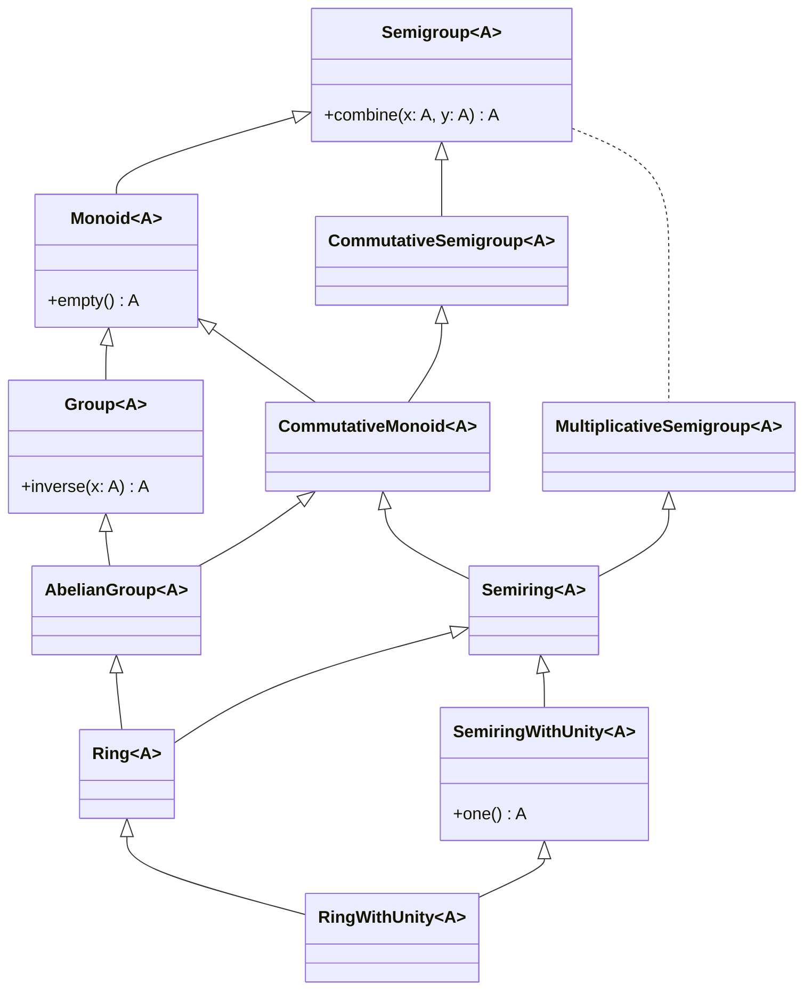

# Кольцо с единицей

## Формальное определение

Кольцо с единицей - это [кольцо](ring.md), которое имеет [мультипликативную единицу](semiring-with-one.md).

Для кольца с единицей должны соблюдаться все законы кольца:

- _Замыкание сложения_ (_closure_): для \\(\forall x, y \in R\\) выполняется \\(x + y \in R\\).
- _Ассоциативность сложения_ (_associativity_): для \\(\forall x, y, z \in R\\) выполняется \\((x + y) + z = x + (y + z)\\).
- _Существование нулевого элемента_: существует \\(\exists 0 \in R\\) такой,
  что для \\(\forall x \in R\\) выполняется \\(0 + x = x + 0 = x\\)
- _Обратимость сложения_: для \\(\forall x \in R\\) существует \\((-x)\\) такой,
  что \\(x + (-x) = (-x) + x = 0\\)
- _Коммутативность сложения_ (_commutative_): для \\(\forall x, y \in R\\) выполняется \\(x + y = y + x\\).
- _Замыкание умножения_ (_closure_): для \\(\forall x, y \in R\\) выполняется \\(x \* y \in R\\).
- _Ассоциативность умножения_ (_associativity_): для \\(\forall x, y, z \in R\\) выполняется \\((x \* y) \* z = x \* (y \* z)\\).
- _Дистрибутивность_ (_distributivus_, _распределительный закон_):
  для \\(\forall x, y, z \in R\\) выполняется \\(x \* (y + z) = x \* y + x \* z\\) и \\((x + y) \* z = x \* z + y \* z\\).

, а также закон тождественности по умножению:

- _Существование единичного элемента_: \\(\exists 1 \in R \quad \forall x \in R \quad x \* 1 = 1 \* x = x\\)

## Определение в виде кода на Scala

```dotty
trait RingWithUnity[A] extends Ring[A], SemiringWithUnity[A]
```

## Законы в виде кода на Scala

```dotty
trait RingWithUnityLaw extends RingLaw, SemiringWithUnityLaw:
  def checkRingWithUnityLaw[A: RingWithUnity](
      x: A,
      y: A,
      z: A
  ): ValidatedNel[String, Unit] =
    checkRingLaw(x, y, z) combine checkSemiringWithUnityLaw(x, y, z)
```

## Примеры

### Числа относительно сложения с 0 и умножения с 1

`(Z, +, *)`

```dotty
given RingWithUnity[Int] with
  val empty: Int                               = 0
  val one: Int                                 = 1
  def combine(x: Int, y: Int): Int             = x + y
  def times(x: Int, y: Int): Int               = x * y
  extension (a: Int) override def inverse: Int = -a
```

## Схема



## Реализация в библиотеках

### Реализация в Spire

```dotty
import spire.algebra.Ring
import spire.math.Rational

Ring.plus(Rational(1, 2), Rational(1, 3))
// val res0: spire.math.Rational = 5/6
Ring.times(Rational(1, 2), Rational(1, 3))
// val res1: spire.math.Rational = 1/6
Ring.pow(Rational(1, 2), 3)
// val res2: spire.math.Rational = 1/8
Ring.negate(Rational(1, 2))
// val res3: spire.math.Rational = -1/2
Ring.minus(Rational(1, 2), Rational(1, 3))
// val res4: spire.math.Rational = 1/6
Ring.zero[Rational]
// val res5: spire.math.Rational = 0
Ring.one[Rational]
// val res6: spire.math.Rational = 1
```

---

**Ссылки:**

- [Spire home page](https://typelevel.org/spire)
- [Spire User's Guide](https://typelevel.org/spire/guide.html)
