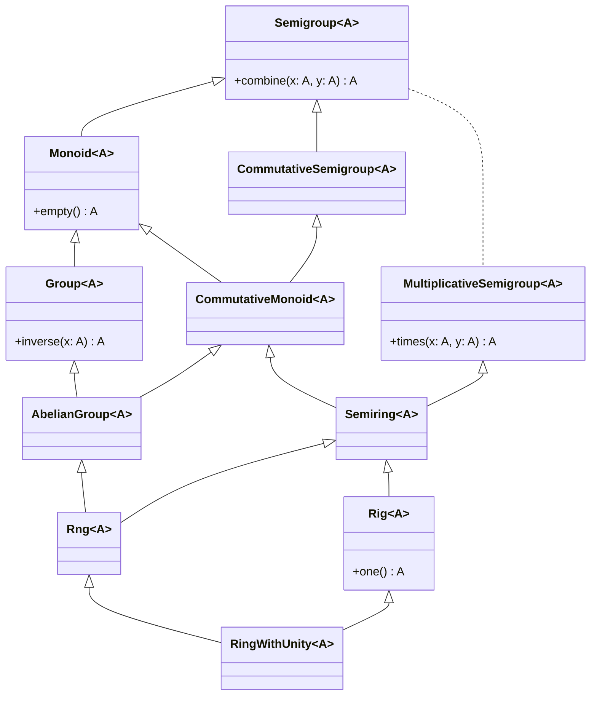



# Кольцо

**Кольцо** — это одна из ключевых алгебраических структур в математике, которая обобщает понятие чисел и операций над ними.
Кольцо определяется как множество, на котором заданы две бинарные операции (обычно называемые сложением и умножением),
удовлетворяющие определённым аксиомам.

Кольцо - это [кольцо без единицы](rng.md), которое имеет [мультипликативную единицу](rig.md).

Для кольца должны соблюдаться следующие законы:

- _Замыкание сложения_ (_closure_): для \\(\forall x, y \in R\\) выполняется \\(x + y \in R\\).
- _Ассоциативность сложения_ (_associativity_): для \\(\forall x, y, z \in R\\) выполняется \\((x + y) + z = x + (y + z)\\).
- _Существование нулевого элемента_: существует \\(\exists 0 \in R\\) такой,
  что для \\(\forall x \in R\\) выполняется \\(0 + x = x + 0 = x\\)
- _Обратимость сложения_: для \\(\forall x \in R\\) существует \\((-x)\\) такой,
  что \\(x + (-x) = (-x) + x = 0\\)
- _Коммутативность сложения_ (_commutative_): для \\(\forall x, y \in R\\) выполняется \\(x + y = y + x\\).
- _Замыкание умножения_ (_closure_): для \\(\forall x, y \in R\\) выполняется \\(x \* y \in R\\).
- _Ассоциативность умножения_ (_associativity_): для \\(\forall x, y, z \in R\\) выполняется \\((x \* y) \* z = x \* (y \* z)\\).
- _Дистрибутивность_ (_distributivus_, _распределительный закон_):
  для \\(\forall x, y, z \in R\\) выполняется \\(x \* (y + z) = x \* y + x \* z\\) и \\((x + y) \* z = x \* z + y \* z\\).
- _Существование единичного элемента_: \\(\exists 1 \in R \quad \forall x \in R \quad x \* 1 = 1 \* x = x\\)

## Код

```dotty
trait RingWithUnity[A] extends Rng[A], Rig[A]
```

### Законы

Законы наследуются от [законов кольца](rng.md) и [полукольца с единицей](rig.md).

## Схема



## Реализация в библиотеках

### [Реализация в Spire](../../libs/spire.md)

`Ring[A]` обеспечивает коммутативные `+`, `zero`, `-`, `*` и `one`.
`Ring[A]` расширяет `Rig[A]` и `Rng[A]`.

```dotty
import spire.algebra.Ring
import spire.math.Rational

Ring.plus(Rational(1, 2), Rational(1, 3))
// val res0: spire.math.Rational = 5/6
Ring.times(Rational(1, 2), Rational(1, 3))
// val res1: spire.math.Rational = 1/6
Ring.pow(Rational(1, 2), 3)
// val res2: spire.math.Rational = 1/8
Ring.negate(Rational(1, 2))
// val res3: spire.math.Rational = -1/2
Ring.minus(Rational(1, 2), Rational(1, 3))
// val res4: spire.math.Rational = 1/6
Ring.zero[Rational]
// val res5: spire.math.Rational = 0
Ring.one[Rational]
// val res6: spire.math.Rational = 1
```

---

**Ссылки:**

- [Ссылка на репозиторий с упражнениями][sample]
- [Spire home page](https://typelevel.org/spire/)
- [Spire User's Guide](https://typelevel.org/spire/guide.html)

[sample]: https://gitverse.ru/scalabook/typeclasses
