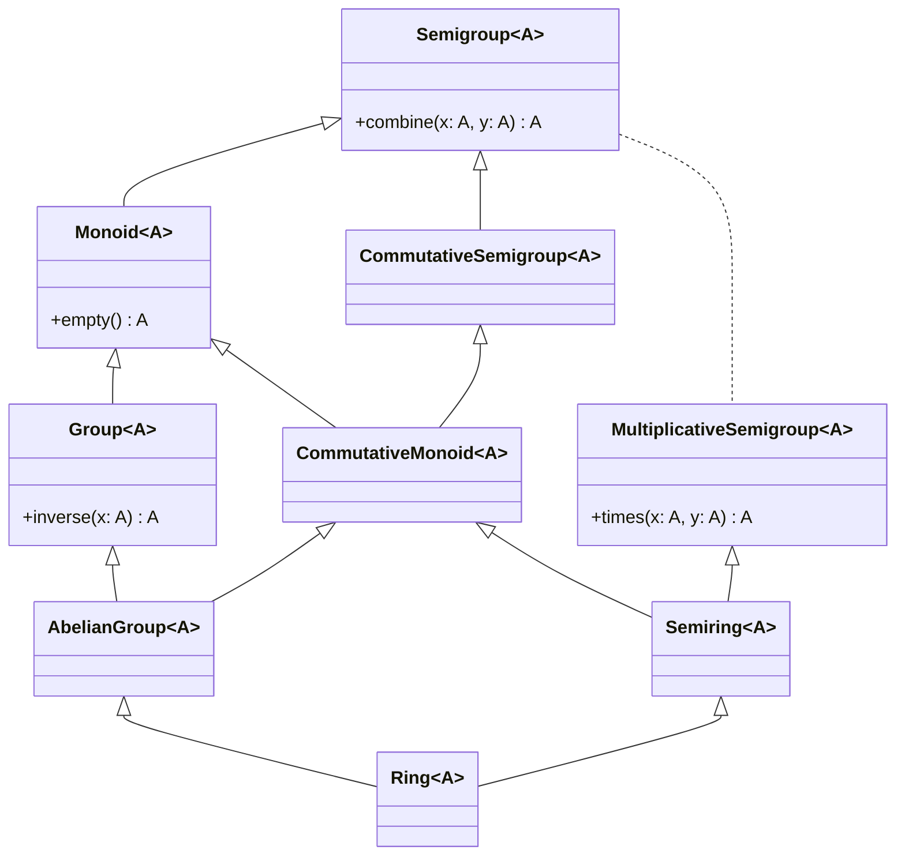

# Кольцо

**Кольцо** — это одна из ключевых алгебраических структур в математике, которая обобщает понятие чисел и операций над ними. 
Кольцо определяется как множество, на котором заданы две бинарные операции (обычно называемые сложением и умножением), 
удовлетворяющие определённым аксиомам.

**Определение кольца**

Кольцо — это множество \\(R\\), на котором определены две бинарные операции:

- **Сложение** (\\(+\\)): коммутативная и ассоциативная операция.
- **Умножение** (\\(\cdot\\)): ассоциативная операция.

Эти операции должны удовлетворять следующим аксиомам:

- **Коммутативность сложения**: \\(a + b = b + a\\) для любых \\(a, b \in R\\).
- **Ассоциативность сложения**: \\((a + b) + c = a + (b + c)\\) для любых \\(a, b, c \in R\\).
- **Наличие нулевого элемента**: существует элемент \\(0 \in R\\) такой, что \\(0 + a = a + 0 = a\\) для любого \\(a \in R\\).
- **Наличие противоположного элемента**: для любого \\(a \in R\\) существует элемент \\(-a \in R\\) такой, что \\(a + (-a) = 0\\).
- **Ассоциативность умножения**: \\((a \cdot b) \cdot c = a \cdot (b \cdot c)\\) для любых \\(a, b, c \in R\\).
- **Дистрибутивность умножения относительно сложения**:
    - \\(a \cdot (b + c) = a \cdot b + a \cdot c\\) (левая дистрибутивность),
    - \\((a + b) \cdot c = a \cdot c + b \cdot c\\) (правая дистрибутивность).

**Дополнительные свойства колец**

- **Кольцо с единицей**:
  Если в кольце существует элемент \\(1 \in R\\) (называемый **единицей**), такой, 
  что \\(a \cdot 1 = 1 \cdot a = a\\) для любого \\(a \in R\\), то такое кольцо называется [**кольцом с единицей**](ring-with-one.md).
- **Коммутативное кольцо**:
  Если операция умножения коммутативна, то есть \\(a \cdot b = b \cdot a\\) для любых \\(a, b \in R\\), 
  то такое кольцо называется [**коммутативным кольцом**](cring.md).
- **Область целостности**:
  Коммутативное кольцо с единицей, в котором нет делителей нуля (то есть если \\(a \cdot b = 0\\), то \\(a = 0\\) или \\(b = 0\\)), 
  называется [**областью целостности**](cring-with-one.md).
- **Тело и поле**:
    - **Тело** — это кольцо с единицей, в котором каждый ненулевой элемент имеет обратный по умножению.
    - [**Поле**](field.md) — это коммутативное тело.

**Примеры колец**

- **Кольцо целых чисел \\(\mathbb{Z}\\)**:
    - Операции: сложение и умножение.
    - Нулевой элемент: \\(0\\).
    - Единичный элемент: \\(1\\).
    - Коммутативное кольцо с единицей.
- **Кольцо многочленов \\(\mathbb{R}\[x\]\\)**:
    - Операции: сложение и умножение многочленов.
    - Нулевой элемент: нулевой многочлен.
    - Единичный элемент: многочлен \\(1\\).
    - Коммутативное кольцо с единицей.
- **Кольцо матриц \\(M_n(\mathbb{R})\\)**:
    - Операции: сложение и умножение матриц.
    - Нулевой элемент: нулевая матрица.
    - Единичный элемент: единичная матрица.
    - Некоммутативное кольцо с единицей (если \\(n > 1\\)).
- **Кольцо вычетов \\(\mathbb{Z}/n\mathbb{Z}\\)**:
    - Операции: сложение и умножение по модулю \\(n\\).
    - Нулевой элемент: \\(0\\).
    - Единичный элемент: \\(1\\).
    - Коммутативное кольцо с единицей.
- **Кольцо функций \\(C(\[a, b\])\\)**:
    - Множество: непрерывные функции на отрезке \\(\[a, b\]\\).
    - Операции: поточечное сложение и умножение функций.
    - Нулевой элемент: нулевая функция.
    - Единичный элемент: функция, тождественно равная \\(1\\).
    - Коммутативное кольцо с единицей.

**Зачем нужны кольца?**

Кольца играют важную роль в математике и её приложениях:

- **Алгебра**: кольца являются одной из основных алгебраических структур, изучаемых в абстрактной алгебре.
- **Теория чисел**: кольца используются для изучения свойств чисел, например, в теории делимости.
- **Геометрия**: кольца многочленов применяются в алгебраической геометрии.
- **Физика**: кольца используются для описания симметрий в физических системах.
- **Криптография**: кольца вычетов применяются в алгоритмах шифрования.

## Формальное определение

Кольцо (Ring) - это [полукольцо](semiring.md), являющееся [абелевой группой](abgroup.md) по сложению.

Учитывая множество `R` и операции `+` и `*`, 
мы говорим, что `(R, +, *)` - это кольцо, если оно удовлетворяет следующим свойствам:

- `(R, +)` является [абелевой группой](abgroup.md)
- Для любых `x` и `y ∈ R`: `x * y ∈ R`.
- Для любых `x`, `y` и `z ∈ R`: `(x * y) * z = x * (y * z)`.
- Для любых `x`, `y` и `z ∈ R`: `x * (y + z) = x * y + x * z` и `(x + y) * z = x * z + y * z`.

Законы кольца:

- _Замыкание сложения_ (_closure_): для \\(\forall x, y \in R\\) выполняется \\(x + y \in R\\).
- _Ассоциативность сложения_ (_associativity_): для \\(\forall x, y, z \in R\\) выполняется \\((x + y) + z = x + (y + z)\\).
- _Существование нулевого элемента_: существует \\(\exists 0 \in R\\) такой,
  что для \\(\forall x \in R\\) выполняется \\(0 + x = x + 0 = x\\)
- _Обратимость сложения_: для \\(\forall x \in R\\) существует \\((-x)\\) такой,
  что \\(x + (-x) = (-x) + x = 0\\)
- _Коммутативность сложения_ (_commutative_): для \\(\forall x, y \in R\\) выполняется \\(x + y = y + x\\).
- _Замыкание умножения_ (_closure_): для \\(\forall x, y \in R\\) выполняется \\(x \* y \in R\\).
- _Ассоциативность умножения_ (_associativity_): для \\(\forall x, y, z \in R\\) выполняется \\((x \* y) \* z = x \* (y \* z)\\).
- _Дистрибутивность_ (_distributivus_, _распределительный закон_):
  для \\(\forall x, y, z \in R\\) выполняется \\(x \* (y + z) = x \* y + x \* z\\) и \\((x + y) \* z = x \* z + y \* z\\).

## Код

```dotty
trait Ring[A] extends AbGroup[A], Semiring[A]
```

### Числа относительно сложения с 0 и умножения

`(Z, +, *)`

```dotty
given Ring[Int] with
  val empty                                    = 0
  def combine(x: Int, y: Int): Int             = x + y
  def times(x: Int, y: Int): Int               = x * y
  extension (a: Int) override def inverse: Int = -a
```

### Матрицы

Набор квадратных матриц заданного размера представляет собой кольцо.

### Законы

Законы наследуются от [законов абелевой группы](abgroup.md) и [полукольца](semiring.md).

## Схема



## Реализация в библиотеках

### Реализация в Spire

```dotty
import spire.algebra.Rng
import spire.math.Rational

Rng.plus(Rational(1, 2), Rational(1, 3))
// val res0: spire.math.Rational = 5/6
Rng.times(Rational(1, 2), Rational(1, 3))
// val res1: spire.math.Rational = 1/6
Rng.pow(Rational(1, 2), 3)
// val res2: spire.math.Rational = 1/8
Rng.negate(Rational(1, 2))
// val res3: spire.math.Rational = -1/2
Rng.minus(Rational(1, 2), Rational(1, 3))
// val res4: spire.math.Rational = 1/6
Rng.zero[Rational]
// val res5: spire.math.Rational = 0
```

---

**Ссылки:**

- [Algebird](https://twitter.github.io/algebird/typeclasses/ring.html)
- [Spire home page](https://typelevel.org/spire)
- [Spire User's Guide](https://typelevel.org/spire/guide.html)
- [Wikipedia](https://ru.wikipedia.org/wiki/%D0%9A%D0%BE%D0%BB%D1%8C%D1%86%D0%BE_(%D0%BC%D0%B0%D1%82%D0%B5%D0%BC%D0%B0%D1%82%D0%B8%D0%BA%D0%B0))
