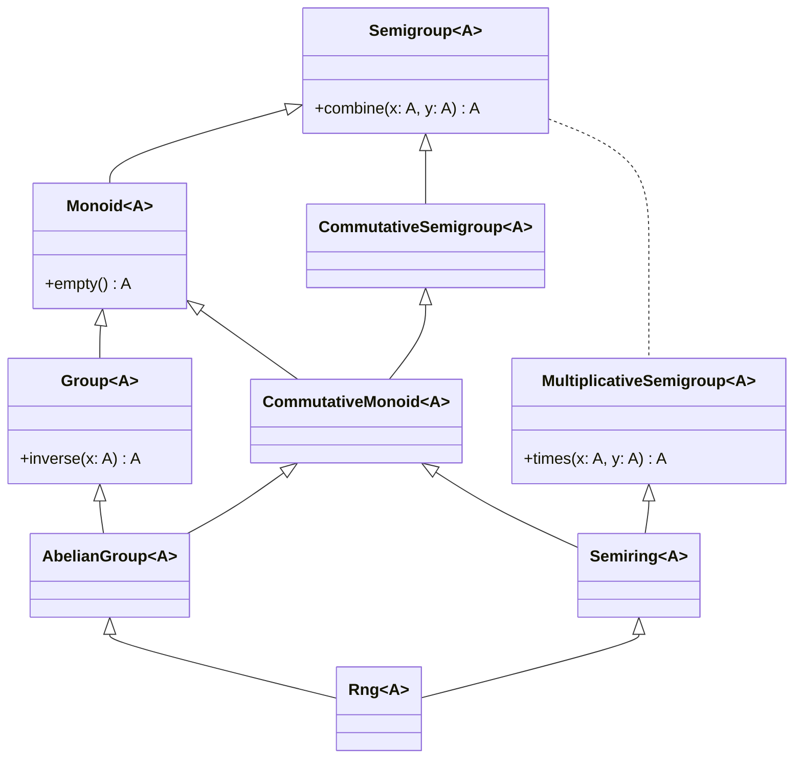

# Кольцо без единицы

Учитывая множество `R` и операции `+` и `*`, 
мы говорим, что `(R, +, *)` - это кольцо без единицы, если оно удовлетворяет следующим свойствам:

- `(R, +)` является [абелевой группой](abgroup.md)
- Для любых `x` и `y ∈ R`: `x * y ∈ R`.
- Для любых `x`, `y` и `z ∈ R`: `(x * y) * z = x * (y * z)`.
- Для любых `x`, `y` и `z ∈ R`: `x * (y + z) = x * y + x * z` и `(x + y) * z = x * z + y * z`.

Законы кольца без единицы:

- _Замыкание сложения_ (_closure_): для \\(\forall x, y \in R\\) выполняется \\(x + y \in R\\).
- _Ассоциативность сложения_ (_associativity_): для \\(\forall x, y, z \in R\\) выполняется \\((x + y) + z = x + (y + z)\\).
- _Существование нулевого элемента_: существует \\(\exists 0 \in R\\) такой,
  что для \\(\forall x \in R\\) выполняется \\(0 + x = x + 0 = x\\)
- _Обратимость сложения_: для \\(\forall x \in R\\) существует \\((-x)\\) такой,
  что \\(x + (-x) = (-x) + x = 0\\)
- _Коммутативность сложения_ (_commutative_): для \\(\forall x, y \in R\\) выполняется \\(x + y = y + x\\).
- _Замыкание умножения_ (_closure_): для \\(\forall x, y \in R\\) выполняется \\(x \* y \in R\\).
- _Ассоциативность умножения_ (_associativity_): для \\(\forall x, y, z \in R\\) выполняется \\((x \* y) \* z = x \* (y \* z)\\).
- _Дистрибутивность_ (_distributivus_, _распределительный закон_):
  для \\(\forall x, y, z \in R\\) выполняется \\(x \* (y + z) = x \* y + x \* z\\) и \\((x + y) \* z = x \* z + y \* z\\).

## Код

```dotty
trait Rng[A] extends AbelianGroup[A], Semiring[A]
```

### Законы

Законы наследуются от [законов абелевой группы](abgroup.md) и [полукольца](semiring.md).

## Схема



## Реализация в библиотеках

### [Реализация в Spire](../../libs/spire.md)

`Rng[A]` обеспечивает коммутативные `+`, `zero`, `-`, и `*`.
`Rng[A]` расширяет `Semiring[A]` и `AdditiveAbGroup[A]`.

- `negate` (`-`): обратная операция сложению
- `minus` (`-`): вычитание
- `zero`: аддитивное тождество (такой элемент, что для любого `x` из множества `x + zero = x`)

```dotty
import spire.algebra.Rng
import spire.math.Rational

Rng.plus(Rational(1, 2), Rational(1, 3))
// val res0: spire.math.Rational = 5/6
Rng.times(Rational(1, 2), Rational(1, 3))
// val res1: spire.math.Rational = 1/6
Rng.pow(Rational(1, 2), 3)
// val res2: spire.math.Rational = 1/8
Rng.negate(Rational(1, 2))
// val res3: spire.math.Rational = -1/2
Rng.minus(Rational(1, 2), Rational(1, 3))
// val res4: spire.math.Rational = 1/6
Rng.zero[Rational]
// val res5: spire.math.Rational = 0
```

---

**Ссылки:**

- [Ссылка на репозиторий с упражнениями][sample]
- [Algebird](https://twitter.github.io/algebird/typeclasses/ring.html)
- [Spire home page](https://typelevel.org/spire/)
- [Spire User's Guide](https://typelevel.org/spire/guide.html)
- [Wikipedia](https://ru.wikipedia.org/wiki/%D0%9A%D0%BE%D0%BB%D1%8C%D1%86%D0%BE_(%D0%BC%D0%B0%D1%82%D0%B5%D0%BC%D0%B0%D1%82%D0%B8%D0%BA%D0%B0))

[sample]: https://gitverse.ru/scalabook/typeclasses
