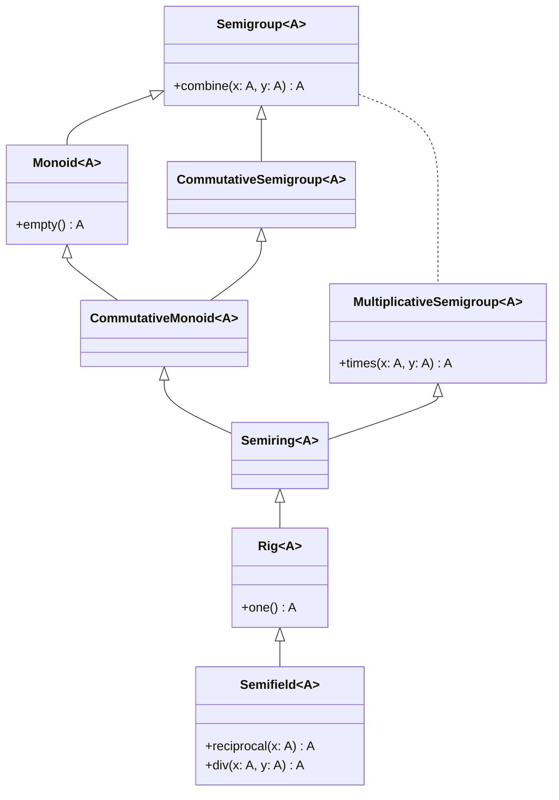

# Полуполе

Полуполе - это [полукольцо с единицей](rig.md), в котором каждый ненулевой элемент имеет обратный относительно умножения.

Для полуполя должны соблюдаться следующие законы:

- _Замыкание сложения_ (_closure_): для \\(\forall x, y \in S\\) выполняется \\(x + y \in S\\).
- _Ассоциативность сложения_ (_associativity_): для \\(\forall x, y, z \in S\\) выполняется \\((x + y) + z = x + (y + z)\\).
- _Существование нулевого элемента_: существует \\(\exists 0 \in S\\) такой,
  что для \\(\forall x \in S\\) выполняется \\(0 + x = x + 0 = x\\)
- _Коммутативность сложения_ (_commutative_): для \\(\forall x, y \in S\\) выполняется \\(x + y = y + x\\).
- _Замыкание умножения_ (_closure_): для \\(\forall x, y \in S\\) выполняется \\(x \* y \in S\\).
- _Ассоциативность умножения_ (_associativity_): для \\(\forall x, y, z \in S\\) выполняется \\((x \* y) \* z = x \* (y \* z)\\).
- _Дистрибутивность_ (_distributivus_, _распределительный закон_):
  для \\(\forall x, y, z \in S\\) выполняется \\(x \* (y + z) = x \* y + x \* z\\) и \\((x + y) \* z = x \* z + y \* z\\).
- _Мультипликативное свойство нуля_: \\(a \* 0 = 0 \* a = 0\\)
- _Существование единичного элемента_: \\(\exists 1 \in S \quad \forall x \in S \quad x \* 1 = 1 \* x = x\\)
- _Наличие обратного элемента_: для любого \\(a \in F\\), \\(a \neq 0\\), существует элемент \\(a^{-1} \in F\\) такой, что \\(a \cdot a^{-1} = 1\\).

## Код

```dotty
trait Semifield[A] extends Rig[A]:
  extension (a: A)
    def reciprocal: A

  def div(x: A, y: A): A = times(x, y.reciprocal)
```

## Схема



---

**Ссылки:**

- [Ссылка на репозиторий с упражнениями][sample]
- [Spire home page](https://typelevel.org/spire/)
- [Spire User's Guide](https://typelevel.org/spire/guide.html)
- [Wikipedia](https://ru.wikipedia.org/wiki/%D0%9F%D0%BE%D0%BB%D1%83%D0%BA%D0%BE%D0%BB%D1%8C%D1%86%D0%BE)

[sample]: https://gitverse.ru/scalabook/typeclasses
