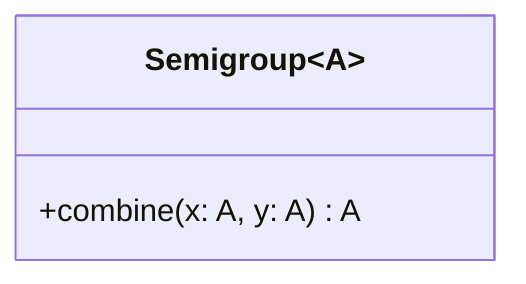



# Полугруппа

**Полугруппа** – это важная математическая структура, 
которая лежит в основе многих понятий современной алгебры и теории категорий. 
Она состоит из множества элементов и одной бинарной операции, которая обладает свойством ассоциативности. 
В отличие от [групп](group.md) и [моноидов](monoid.md), полугруппа не требует наличия нейтрального элемента 
или обратного элемента для каждого своего элемента.

Полугруппы позволяют абстрагироваться от конкретных типов данных 
и работать с операциями объединения, сложения или конкатенации, 
что делает их полезными в различных сценариях, особенно при работе с коллекциями и агрегации данных.

**Что такое полугруппа?**

**Полугруппа** — это структура, состоящая из:

- **Множества элементов** (например, числа, строки, списки).
- **Бинарной операции** (например, сложение, конкатенация), которая объединяет два элемента множества в один.

При этом выполняется одно ключевое свойство:

- **Ассоциативность**: Результат операции не зависит от порядка вычислений. Например, `(a + b) + c` равно `a + (b + c)`.

Важно отметить, что в полугруппе **отсутствует нейтральный элемент**. 
Это делает полугруппы более общим понятием, чем моноиды, и позволяет работать с типами данных, 
для которых невозможно или не имеет смысла определить нейтральный элемент.

**Зачем нужны полугруппы?**

Полугруппы полезны, потому что они:

- **Абстрагируют операции объединения**: Вы можете работать с разными типами данных (числа, строки, списки и т.д.),
  используя один и тот же интерфейс для объединения.
- **Упрощают композицию**: Полугруппы позволяют легко объединять данные,
  что особенно полезно при работе с коллекциями или агрегации результатов.
- **Расширяют возможности моноидов**: Если моноид требует наличия нейтрального элемента,
  то полугруппа может быть применима в более широком диапазоне задач, где такой элемент не определен.
- **Улучшают читаемость кода**: Использование полугрупп делает код более декларативным и понятным,
  так как вы явно выражаете намерение объединить данные.

**Примеры полугрупп**

Некоторые примеры полугрупп, которые часто встречаются в программировании:

- Сложение чисел: Операция — сложение.
- Умножение чисел: Операция — умножение.
- Конкатенация строк: Операция — конкатенация.
- Объединение множеств: Операция — объединение.
- Списки: Операция — конкатенация списков.

> Обратите внимание, что в этих примерах отсутствует нейтральный элемент, но операция остается ассоциативной.

## Формальное определение

\\((S, +)\\) является полугруппой (_semigroup_) для множества \\(S\\) и операции \\(+\\), 
если удовлетворяет следующим свойствам для любых \\(x, y, z \in S\\):

- _Замыкание_ (_closure_): для \\(\forall x, y \in S\\) выполняется \\(x + y \in S\\).
- _Ассоциативность_ (_associativity_): для \\(\forall x, y, z \in S\\) выполняется \\((x + y) + z = x + (y + z)\\).

Также говорится, что _S образует полугруппу относительно +_.

## Код

```dotty
trait Semigroup[A]:
  def combine(x: A, y: A): A
```

Для операции "сложения" встречаются следующие наименования:
`combine`, `append`, `mappend` (Haskell), `op`, `plus`, `times`.

### Законы

Законы полугруппы принимают следующий вид:

- Замыкание следует из определения функции `combine`: тип результата этой функции совпадает с типом переменных,
  которые она принимает.
  При условии использования при реализации только [чистых функций без побочных эффектов](../../fp/fp/pure_function.md).
- Ассоциативность выражается следующим образом:
  `s.combine(x, s.combine(y, z))` должно быть равно `s.combine(s.combine(x, y), z)`.  
  Это означает, что порядок объединения элементов не влияет на итоговый результат.

## Упражнение 1.1.1: Реализация полугрупп

> [Репозиторий с упражнениями и инструкцией по выполнению][sample]

Ваша задача - заполнив пропущенные части (`???`), реализовать следующие полугруппы:

- Натуральные числа N относительно сложения
- Натуральные числа N относительно умножения
- Строки относительно конкатенации 
- Последовательность относительно операции объединения


```dotty
given additionSemigroup: Semigroup[Int] = 
  (x: Int, y: Int) => ???
    
given multiplicationSemigroup: Semigroup[Int] = 
  (x: Int, y: Int) => ???

given concatenationSemigroup: Semigroup[String] =
  (x: String, y: String) => ??? 
  
given listSemigroup[T]: Semigroup[List[T]] =
  (x: List[T], y: List[T]) => ???  
```

@:note(🔍 Показать решение)

```dotty
given additionSemigroup: Semigroup[Int] = (x: Int, y: Int) => x + y
    
given multiplicationSemigroup: Semigroup[Int] = (x: Int, y: Int) => x * y

given concatenationSemigroup: Semigroup[String] =
  (x: String, y: String) => x + y  
  
given listSemigroup[T]: Semigroup[List[T]] =
  (x: List[T], y: List[T]) => x ++ y      
```

- сложение ассоциативно: `(a + b) + c = a + (b + c)`
- умножение ассоциативно: `(a * b) * c = a * (b * c)`
- конкатенация ассоциативна: 
  ```
    ("first" + "second") + "third" = 
    "first" + ("second" + "third") = 
    "firstsecondthird"
  ```
- объединение последовательностей ассоциативно: 
  ```
  (List(1, 2) ++ List(3, 4)) ++ List(5, 6) = 
  List(1, 2) ++ (List(3, 4) ++ List(5, 6)) = 
  List(1, 2, 3, 4, 5, 6)
  ```

**Примеры вызовов**:

```dotty
additionSemigroup.combine(5, 3)
// 8
multiplicationSemigroup.combine(4, 5)
// 20
concatenationSemigroup.combine("Hello, ", "World!")
// "Hello, World!"
listSemigroup[Int].combine(List(1, 2), List(3, 4))
// List(1, 2, 3, 4)
```

@:@

## Дополнительные свойства

Поскольку мы знаем, что `Semigroup#combine` должен быть ассоциативным, мы можем использовать это при написании кода. 
Например, чтобы суммировать `List[Int]`, мы можем выбрать либо `foldLeft`, либо `foldRight`, 
поскольку меняется только ассоциативность.

```dotty
val leftwards = List(1, 2, 3).foldLeft(0)(_ |+| _)

val rightwards = List(1, 2, 3).foldRight(0)(_ |+| _)
```

Ассоциативность также позволяет нам разделить список и суммировать части параллельно, собирая результаты в конце.

```dotty
val list          = List(1, 2, 3, 4, 5)
val (left, right) = list.splitAt(2)
val sumLeft       = left.foldLeft(0)(_ |+| _)
val sumRight      = right.foldLeft(0)(_ |+| _)
val result        = sumLeft |+| sumRight
```

### Степень элемента полугруппы

Также, благодаря ассоциативности, можно корректно определить натуральную степень элемента полугруппы ("сложить n раз") как:

\\(a^{n} = \overset{n}{a + ... + a}\\)

Для степени элемента справедливы соотношения \\(a^{n + m} = a^{m}+a^{n}, (a^{m})^{n} = a^{mn}, \forall n,m \in \mathbb{N}\\).

```dotty
def combineN(a: A, n: Int): Either[String, A] =
  if n <= 0 then
    Left("Repeated combining for semigroups must have n > 0")
  else if n == 1 then
    Right(a)
  else
    @tailrec
    def loop(b: A, k: Int, extra: A): A =
      if k == 1 then combine(b, extra)
      else
        val x = if (k & 1) == 1 then combine(b, extra) else extra
        loop(combine(b, b), k >>> 1, x)

    Right(loop(a, n - 1, a))
```

## Схема



## Реализация в библиотеках

### Реализация в Cats

```dotty
import cats.*
import cats.implicits.*

1 |+| 2                                     // 3
("hello", 123) |+| ("world", 321)           // ("helloworld",444)

val map1 = Map("hello" -> 1, "world" -> 1)
val map2 = Map("hello" -> 2, "cats" -> 3)
Semigroup[Map[String, Int]].combine(map1, map2)
map1 |+| map2
// Map(hello -> 3, cats -> 3, world -> 1)
```

### [Реализация в Spire](../../libs/spire.md)

`Semigroup`:

- `op` (`|+|`): ассоциативная бинарная операция

```dotty
import spire.algebra.Semigroup
import spire.syntax.semigroup.*

1 |+| 2                           // 3
("hello", 123) |+| ("world", 321) // ("helloworld",444)
Semigroup.combineN(3, 5)          // 15
```

## SemigroupK в библиотеке Cats (Полугруппа для конструкторов типов)

```dotty
trait SemigroupK[F[_]]:
  def combineK[A](x: F[A], y: F[A]): F[A]

  def algebra[A]: Semigroup[F[A]] = combineK(_, _)
```

`SemigroupK` имеет структуру, очень похожую на `Semigroup`, но с одним важным отличием: 
`SemigroupK` работает с **конструкторами типов**, принимающими ровно один аргумент. 
Если `Semigroup` оперирует полностью определёнными типами (например, `Int`, `List[Int]` или `Option[Int]`), 
то `SemigroupK` работает с такими конструкторами типов, как `List` и `Option`.

Чтобы понять разницу, представьте конструктор типа как «функцию» в пространстве типов. 
Например, тип `List` можно рассматривать как функцию, которая принимает конкретный тип (скажем, `Int`) 
и возвращает другой конкретный тип — `List[Int]`. 
Такой паттерн в терминологии видов (kinds) обозначается как `* -> *` (читается «звезда в звезду»). 
Для сравнения:

| Тип    | Вид (Kind) | Описание                                    |
|:-------|:-----------|:--------------------------------------------|
| `Int`  | `*`        | Простой конкретный тип                      |
| `List` | `* -> *`   | Конструктор типа, принимающий один аргумент |
| `Map`  | `*,* -> *` | Конструктор типа, принимающий два аргумента |

Именно буква **K** в названии `SemigroupK` отсылает к понятию **Kind** (вид) — она указывает на то, 
что этот класс типов работает на уровне конструкторов, а не на уровне конкретных типов.

### Пример для `List`: одинаковое поведение

Для `List` операция `combine` из `Semigroup` и операция `combineK` из `SemigroupK` ведут себя одинаково — 
обе выполняют конкатенацию списков:

```dotty
import cats.*
import cats.syntax.all.*

SemigroupK[List].combineK(List(1, 2, 3), List(4, 5, 6))
// List(1, 2, 3, 4, 5, 6)
Semigroup[List[Int]].combine(List(1, 2, 3), List(4, 5, 6))
// List(1, 2, 3, 4, 5, 6)
```

Обе стороны этого выражения дают один и тот же результат: `List(1, 2, 3, 4, 5, 6)`. 
Потому что для списков операция объединения тривиальна — она не зависит от типа элементов. 
Будь там `Int`, `String` или что-то ещё, конкатенация работает одинаково.

### Пример для `Option`: принципиальное различие

Для `Option` ситуация кардинально меняется. Здесь поведение `Semigroup` и `SemigroupK` отличается.

### `Semigroup[Option[A]]`

`Semigroup` работает с полностью определённым типом `Option[A]`, где `A` — это конкретный тип. 
Поскольку `A` известен, `Semigroup[Option[A]]` может использовать `Semigroup[A].combine` для объединения внутренних значений. 
Это означает, что:

- Для `Semigroup[Option[Int]]` требуется наличие неявного `Semigroup[Int]` (который, в свою очередь, использует сложение чисел).
- Результатом будет объединение содержимого двух `Option` с использованием операции, определённой для типа `A`.

#### `SemigroupK[Option]`

`SemigroupK[Option]` работает с конструктором типа `Option`, где внутренний тип не определён 
и может быть чем угодно — он является «универсально квантифицированным» (то есть работает для любого `A`). 
Поскольку мы не знаем, какой именно тип лежит внутри, 
у нас нет способа «объединить» два внутренних значения (для этого понадобился бы `Semigroup[A]`, который неизвестен). 
Поэтому у `SemigroupK[Option]` нет выбора, кроме как использовать встроенный метод `orElse` для выбора первого непустого значения:

```dotty
Semigroup[Option[Int]].combine(Some(1), Some(2))
// Результат: Some(3) — числа складываются

SemigroupK[Option].combineK(Some(1), Some(2))
// Результат: Some(1) — выбирается первый Some

SemigroupK[Option].combineK(Some(1), None)
// Результат: Some(1) — выбирается первый Some

SemigroupK[Option].combineK(None, Some(2))
// Результат: Some(2) — выбирается первый непустой
```

### Синтаксис: операторы `|+|` и `<+>`

В Cats есть удобный инлайн-синтаксис для обоих классов типов. 
Следуя соглашениям из библиотеки **scalaz**, используются следующие операторы:

| Оператор | Класс типов  | Описание                                                                       |
|:---------|:-------------|:-------------------------------------------------------------------------------|
| `\|+\|`  | `Semigroup`  | Объединение двух значений с использованием операции из `Semigroup`             |
| `<+>`    | `SemigroupK` | Объединение двух конструкторов типов с использованием операции из `SemigroupK` |

Подготовим значения для примеров:

```dotty
import cats.syntax.all.*

val one            = Option(1)
val two            = Option(2)
val n: Option[Int] = None
```

Обратите внимание на важные детали:

1. Мы используем `Option(1)` вместо `Some(1)` — это гарантирует, что тип значения будет именно `Option[Int]`, 
   а не более конкретный подтип `Some[Int]`. Это необходимо, потому что экземпляры классов типов определены для `Option`, 
   а не для его подтипов.
2. Для `n` мы явно указываем тип `Option[Int]` по той же причине — чтобы компилятор знал, что это `Option`, а не `None.type`.

Теперь сравним поведение операторов:

```dotty
// Semigroup: складывает числа внутри Option
one |+| two
// Результат: Some(3)

// SemigroupK: выбирает первый непустой Option
one <+> two
// Результат: Some(1)

// Semigroup: None + Some = None (так как None не содержит значения для сложения)
n |+| two
// Результат: None

// SemigroupK: None + Some = Some (выбирается первое непустое)
n <+> two
// Результат: Some(2)

// Оба None дают None
n |+| n
// Результат: None
n <+> n
// Результат: None

// Some + None при Semigroup даёт None (потому что у None нет значения для combine)
two |+| n
// Результат: None

// Some + None при SemigroupK даёт Some (выбирается первый непустой)
two <+> n
// Результат: Some(2)
```

### Важное замечание о типах: почему `Some` и `None` не работают

Как уже упоминалось, экземпляр класса типов `SemigroupK` определён для конструктора типа `Option`, 
а не для его подтипов `Some` и `None`. 
Если попытаться использовать оператор `<+>` напрямую с `Some` или `None`, компилятор выдаст ошибку:

```dotty
Some(1) <+> None
// Ошибка: не удаётся найти экземпляр SemigroupK[Some]
// (ожидался SemigroupK[Option], но получили SemigroupK[Some])

None <+> Some(1)
// Ошибка: не удаётся найти экземпляр SemigroupK[None]
// (ожидался SemigroupK[Option], но получили SemigroupK[None])
```

**Почему это происходит?** `Some` и `None` — это отдельные типы, наследующие от `Option`, но не являющиеся самими `Option`. 
В Scala каждый из них является самостоятельным типом, и для них не определены экземпляры `SemigroupK` 
(да и не могли бы быть определены, потому что они не являются конструкторами типов с видом `* -> *`). 
Поэтому всегда следует использовать `Option(...)` или явно указывать тип, чтобы компилятор видел ожидаемый конструктор.

### Когда использовать `SemigroupK` вместо `Semigroup`

| Сценарий                                                                     | Предпочтительный класс типов | Причина                                                        |
|:-----------------------------------------------------------------------------|:-----------------------------|:---------------------------------------------------------------|
| Известен конкретный тип элементов, и для них определена операция объединения | `Semigroup`                  | Можно использовать операцию `combine` для внутренних значений  |
| Тип элементов неизвестен или может быть любым (универсальный код)            | `SemigroupK`                 | Используется структура контейнера без знания о внутреннем типе |
| Нужно объединить два контейнера, выбирая первый непустой (как для `Option`)  | `SemigroupK`                 | `combineK` даёт именно такое поведение                         |
| Нужно объединить содержимое контейнеров с учётом типа элементов              | `Semigroup`                  | `combine` учитывает тип `A` и его `Semigroup`                  |

### Закон для `SemigroupK`

Для `SemigroupK` действует тот же закон ассоциативности, что и для `Semigroup`:

```dotty
combineK(x, combineK(y, z)) == combineK(combineK(x, y), z)
```

Это означает, что порядок группировки при объединении не влияет на результат. 
Для `Option` это свойство выполняется, поскольку `orElse` ассоциативен:

```dotty
val a              = Option(1)
val b: Option[Int] = None
val c              = Option(2)

(a <+> b) <+> c == a <+> (b <+> c)
// true, так как в обоих случаях получится Some(1)
```

### Практические применения `SemigroupK`

1. **Объединение коллекций:** `SemigroupK[List]` и `SemigroupK[Vector]` позволяют объединять коллекции без привязки к типу элементов.
2. **Выбор первого успешного значения:** Для `Option`, `Either` (через `EitherK`) или других монадичных типов `SemigroupK` 
   даёт возможность выбрать первый успешный результат.
3. **Композиция парсеров:** При построении парсеров часто нужно попробовать один парсер, а если он не сработал — другой. 
   `SemigroupK` идеально подходит для этой задачи.
4. **Альтернативы в HTTP-маршрутизации:** При определении маршрутов часто применяется стратегия «первый подходящий», 
   что естественно выражается через `combineK`.

### Итого

| Аспект                              | `Semigroup`                                            | `SemigroupK`                                      |
|:------------------------------------|:-------------------------------------------------------|:--------------------------------------------------|
| **Оперирует**                       | Конкретными типами (`Int`, `List[Int]`, `Option[Int]`) | Конструкторами типов (`List`, `Option`, `Either`) |
| **Вид (Kind)**                      | `*`                                                    | `* -> *`                                          |
| **Оператор**                        | `\|+\|`                                                | `<+>`                                             |
| **Метод**                           | `combine`                                              | `combineK`                                        |
| **Знает ли о внутреннем типе `A`?** | Да                                                     | Нет                                               |
| **Пример для `Option`**             | Складывает числа внутри `Some`                         | Выбирает первый непустой `Option`                 |
| **Требует ли `Semigroup[A]`?**      | Да, для `Option[A]`                                    | Нет                                               |

---

**Ссылки:**

- [Ссылка на репозиторий с упражнениями][sample]
- [Классические абстракции используемые в ФП](https://habr.com/ru/articles/896660/)
- [Algebird](https://twitter.github.io/algebird/typeclasses/semigroup.html)
- [Cats](https://typelevel.org/cats/typeclasses/semigroup.html)
- [Herding Cats](http://eed3si9n.com/herding-cats/Semigroup.html)
- [Learn Functional Programming course/tutorial on Scala](https://github.com/dehun/learn-fp)
- [Learning Scalaz](http://eed3si9n.com/learning-scalaz/Monoid.html#Monoid)
- [Math world](https://mathworld.wolfram.com/Semigroup.html)
- [Scala with Cats](https://scalawithcats.com/dist/scala-with-cats.html#definition-of-a-semigroup)
- [Scalaz API](https://javadoc.io/doc/org.scalaz/scalaz-core_3/7.3.6/scalaz/Semigroup.html)
- [Spire home page](https://typelevel.org/spire/)
- [Symbolic operators and type classes for Cats](https://typelevel.org/blog/2015/08/07/symbolic-operators.html)
- [Wikipedia](https://ru.wikipedia.org/wiki/%D0%9F%D0%BE%D0%BB%D1%83%D0%B3%D1%80%D1%83%D0%BF%D0%BF%D0%B0)

[sample]: https://gitverse.ru/scalabook/typeclasses
