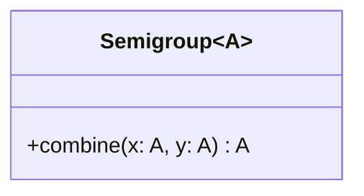



# Полугруппа

**Полугруппа** – это важная математическая структура, 
которая лежит в основе многих понятий современной алгебры и теории категорий. 
Она состоит из множества элементов и одной бинарной операции, которая обладает свойством ассоциативности. 
В отличие от [групп](group.md) и [моноидов](monoid.md), полугруппа не требует наличия нейтрального элемента 
или обратного элемента для каждого своего элемента.

Полугруппы позволяют абстрагироваться от конкретных типов данных 
и работать с операциями объединения, сложения или конкатенации, 
что делает их полезными в различных сценариях, особенно при работе с коллекциями и агрегации данных.

**Что такое полугруппа?**

**Полугруппа** — это структура, состоящая из:

- **Множества элементов** (например, числа, строки, списки).
- **Бинарной операции** (например, сложение, конкатенация), которая объединяет два элемента множества в один.

При этом выполняется одно ключевое свойство:

- **Ассоциативность**: Результат операции не зависит от порядка вычислений. Например, `(a + b) + c` равно `a + (b + c)`.

Важно отметить, что в полугруппе **отсутствует нейтральный элемент**. 
Это делает полугруппы более общим понятием, чем моноиды, и позволяет работать с типами данных, 
для которых невозможно или не имеет смысла определить нейтральный элемент.

**Зачем нужны полугруппы?**

Полугруппы полезны, потому что они:

- **Абстрагируют операции объединения**: Вы можете работать с разными типами данных (числа, строки, списки и т.д.),
  используя один и тот же интерфейс для объединения.
- **Упрощают композицию**: Полугруппы позволяют легко объединять данные,
  что особенно полезно при работе с коллекциями или агрегации результатов.
- **Расширяют возможности моноидов**: Если моноид требует наличия нейтрального элемента,
  то полугруппа может быть применима в более широком диапазоне задач, где такой элемент не определен.
- **Улучшают читаемость кода**: Использование полугрупп делает код более декларативным и понятным,
  так как вы явно выражаете намерение объединить данные.

**Примеры полугрупп**

Некоторые примеры полугрупп, которые часто встречаются в программировании:

- Сложение чисел: Операция — сложение.
- Умножение чисел: Операция — умножение.
- Конкатенация строк: Операция — конкатенация.
- Объединение множеств: Операция — объединение.
- Списки: Операция — конкатенация списков.

> Обратите внимание, что в этих примерах отсутствует нейтральный элемент, но операция остается ассоциативной.

## Формальное определение

\\((S, +)\\) является полугруппой (_semigroup_) для множества \\(S\\) и операции \\(+\\), 
если удовлетворяет следующим свойствам для любых \\(x, y, z \in S\\):

- _Замыкание_ (_closure_): для \\(\forall x, y \in S\\) выполняется \\(x + y \in S\\).
- _Ассоциативность_ (_associativity_): для \\(\forall x, y, z \in S\\) выполняется \\((x + y) + z = x + (y + z)\\).

Также говорится, что _S образует полугруппу относительно +_.

## Код

```dotty
trait Semigroup[A]:
  def combine(x: A, y: A): A
```

Для операции "сложения" встречаются следующие наименования:
`combine`, `append`, `mappend` (Haskell), `op`, `plus`, `times`.

### Законы

Законы полугруппы принимают следующий вид:

- Замыкание следует из определения функции `combine`: тип результата этой функции совпадает с типом переменных,
  которые она принимает.
  При условии использования при реализации только [чистых функций без побочных эффектов](../../fp/fp/pure_function.md).
- Ассоциативность выражается следующим образом:
  `s.combine(x, s.combine(y, z))` должно быть равно `s.combine(s.combine(x, y), z)`.  
  Это означает, что порядок объединения элементов не влияет на итоговый результат.

## Упражнение 1.1.1: Реализация полугрупп

> [Репозиторий с упражнениями и инструкцией по выполнению][sample]

Ваша задача - заполнив пропущенные части (`???`), реализовать следующие полугруппы:

- Натуральные числа N относительно сложения
- Натуральные числа N относительно умножения
- Строки относительно конкатенации 
- Последовательность относительно операции объединения


```dotty
given additionSemigroup: Semigroup[Int] = 
  (x: Int, y: Int) => ???
    
given multiplicationSemigroup: Semigroup[Int] = 
  (x: Int, y: Int) => ???

given concatenationSemigroup: Semigroup[String] =
  (x: String, y: String) => ??? 
  
given listSemigroup[T]: Semigroup[List[T]] =
  (x: List[T], y: List[T]) => ???  
```

@:note(🔍 Показать решение)

```dotty
given additionSemigroup: Semigroup[Int] = (x: Int, y: Int) => x + y
    
given multiplicationSemigroup: Semigroup[Int] = (x: Int, y: Int) => x * y

given concatenationSemigroup: Semigroup[String] =
  (x: String, y: String) => x + y  
  
given listSemigroup[T]: Semigroup[List[T]] =
  (x: List[T], y: List[T]) => x ++ y      
```

- сложение ассоциативно: `(a + b) + c = a + (b + c)`
- умножение ассоциативно: `(a * b) * c = a * (b * c)`
- конкатенация ассоциативна: 
  ```
    ("first" + "second") + "third" = 
    "first" + ("second" + "third") = 
    "firstsecondthird"
  ```
- объединение последовательностей ассоциативно: 
  ```
  (List(1, 2) ++ List(3, 4)) ++ List(5, 6) = 
  List(1, 2) ++ (List(3, 4) ++ List(5, 6)) = 
  List(1, 2, 3, 4, 5, 6)
  ```

**Примеры вызовов**:

```dotty
additionSemigroup.combine(5, 3)
// 8
multiplicationSemigroup.combine(4, 5)
// 20
concatenationSemigroup.combine("Hello, ", "World!")
// "Hello, World!"
listSemigroup[Int].combine(List(1, 2), List(3, 4))
// List(1, 2, 3, 4)
```

@:@

## Дополнительные свойства

Благодаря ассоциативности, можно корректно определить натуральную степень элемента полугруппы ("сложить n раз") как:

\\(a^{n} = \overset{n}{a + ... + a}\\)

Для степени элемента справедливы соотношения \\(a^{n + m} = a^{m}+a^{n}, (a^{m})^{n} = a^{mn}, \forall n,m \in \mathbb{N}\\).

## Схема



## Реализация в библиотеках

### Реализация в Cats

```dotty
import cats.*
import cats.implicits.*

1 |+| 2                                     // 3
("hello", 123) |+| ("world", 321)           // ("helloworld",444)
```

### Реализация в Spire

```dotty
import spire.algebra.Semigroup
import spire.syntax.semigroup.*

1 |+| 2                           // 3
("hello", 123) |+| ("world", 321) // ("helloworld",444)
Semigroup.combineN(3, 5)          // 15
```

---

**Ссылки:**

- [Ссылка на репозиторий с упражнениями][sample]
- [Классические абстракции используемые в ФП](https://habr.com/ru/articles/896660/)
- [Algebird](https://twitter.github.io/algebird/typeclasses/semigroup.html)
- [Cats](https://typelevel.org/cats/typeclasses/semigroup.html)
- [Herding Cats](http://eed3si9n.com/herding-cats/Semigroup.html)
- [Learn Functional Programming course/tutorial on Scala](https://github.com/dehun/learn-fp)
- [Learning Scalaz](http://eed3si9n.com/learning-scalaz/Monoid.html#Monoid)
- [Math world](https://mathworld.wolfram.com/Semigroup.html)
- [Scala with Cats](https://scalawithcats.com/dist/scala-with-cats.html#definition-of-a-semigroup)
- [Scalaz API](https://javadoc.io/doc/org.scalaz/scalaz-core_3/7.3.6/scalaz/Semigroup.html)
- [Spire home page](https://typelevel.org/spire/)
- [Symbolic operators and type classes for Cats](https://typelevel.org/blog/2015/08/07/symbolic-operators.html)
- [Wikipedia](https://ru.wikipedia.org/wiki/%D0%9F%D0%BE%D0%BB%D1%83%D0%B3%D1%80%D1%83%D0%BF%D0%BF%D0%B0)

[sample]: https://gitverse.ru/scalabook/typeclasses
