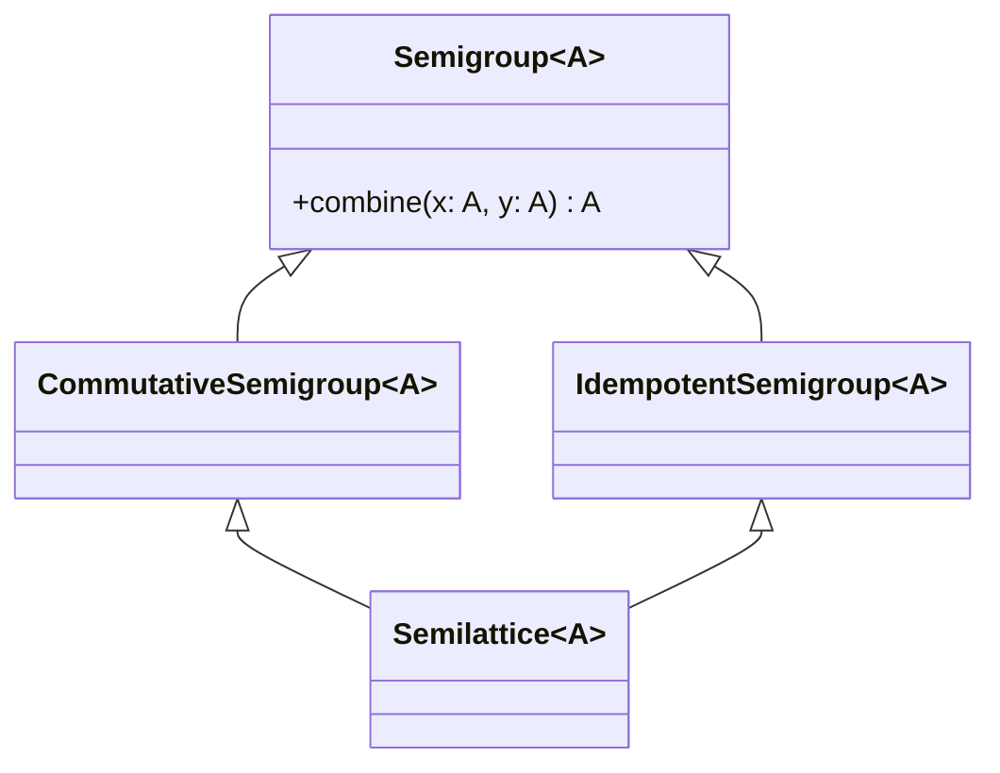

# Полурешетка

`Semilattice[A]` - [коммутативная](csemigroup.md) и [идемпотентная](band.md) полугруппа.

Законы:

- _Замыкание_ (_closure_): для \\(\forall x, y \in CS\\) выполняется \\(x + y \in CS\\).
- _Ассоциативность_ (_associativity_): для \\(\forall x, y, z \in CS\\) выполняется \\((x + y) + z = x + (y + z)\\).
- _Коммутативность_ (_commutative_): для \\(\forall x, y \in CS\\) выполняется \\(x + y = y + x\\).
- _Идемпотентность_ (_idempotency_): для \\(\forall x \in B\\) выполняется \\(x + x = x\\).

## Код

```dotty
trait Semilattice[A] extends Band[A] with CSemigroup[A]
```

### Законы

- Замыкание следует из определения функции `combine`: тип результата этой функции совпадает с типом переменных,
  которые она принимает.
- Ассоциативность выражается следующим образом:
  `s.combine(x, s.combine(y, z))` должно быть равно `s.combine(s.combine(x, y), z)`.  
  Это означает, что порядок объединения элементов не влияет на итоговый результат.
- Идемпотентность формулируется так:  
  `s.combine(x, x)` должно быть равно `x`.  
  Это означает, что объединение элемента с самим собой не изменяет его.
- Коммутативность означает, что порядок элементов при объединении не важен.
  Другими словами, результат операции `combine` будет одинаковым, независимо от того,
  в каком порядке вы передаёте элементы `x` и `y`.
  Это можно записать так: `cs.combine(x, y) == cs.combine(y, x)`

## Схема



## Реализация в библиотеках

### Реализация в Cats

```dotty
import cats.kernel.Semilattice
import cats.implicits.*

Semilattice.combine(Set(1, 2), Set(2, 3))
// Set(1, 2, 3)
```

---

**Ссылки:**

- [Ссылка на репозиторий с упражнениями][sample]
- [Spire home page](https://typelevel.org/spire/)

[sample]: https://gitverse.ru/scalabook/typeclasses
