

# Полукольцо с единицей

**Полукольцо с единицей** — это [полукольцо](semiring.md), в котором существует нейтральный элемент относительно операции умножения. 
Этот элемент называется **единицей** и обозначается обычно как \\(1\\). 

**Определение полукольца с единицей**

Полукольцо с единицей — это множество \\(S\\), на котором определены две бинарные операции:

- **Сложение** (\\(+\\)): коммутативная и ассоциативная операция.
- **Умножение** (\\(\cdot\\)): ассоциативная операция.

Эти операции должны удовлетворять следующим аксиомам:

- **Коммутативность сложения**: \\(a + b = b + a\\) для любых \\(a, b \in S\\).
- **Ассоциативность сложения**: \\((a + b) + c = a + (b + c)\\) для любых \\(a, b, c \in S\\).
- **Ассоциативность умножения**: \\((a \cdot b) \cdot c = a \cdot (b \cdot c)\\) для любых \\(a, b, c \in S\\).
- **Дистрибутивность умножения относительно сложения**:
    - \\(a \cdot (b + c) = a \cdot b + a \cdot c\\) (дистрибутивность слева),
    - \\((a + b) \cdot c = a \cdot c + b \cdot c\\) (дистрибутивность справа).
- **Наличие нулевого элемента**: существует элемент \\(0 \in S\\) такой, 
  что \\(0 + a = a + 0 = a\\) и \\(a \cdot 0 = 0 \cdot a = 0\\) для любого \\(a \in S\\).
- **Наличие единичного элемента**: существует элемент \\(1 \in S\\) такой, 
  что \\(a \cdot 1 = 1 \cdot a = a\\) для любого \\(a \in S\\).

**Примеры полуколец с единицей**

- **Множество натуральных чисел \\(\mathbb{N}\\) с обычными сложением и умножением**:
    - Сложение и умножение ассоциативны и коммутативны.
    - Нулевой элемент: \\(0\\).
    - Единичный элемент: \\(1\\).
    - Дистрибутивность выполняется.
- **Множество неотрицательных действительных чисел \\(\mathbb{R}_{\geq 0}\\) с обычными сложением и умножением**:
    - Сложение и умножение ассоциативны и коммутативны.
    - Нулевой элемент: \\(0\\).
    - Единичный элемент: \\(1\\).
    - Дистрибутивность выполняется.
- **Булево полукольцо**:
    - Множество: \\(\{0, 1\}\\).
    - Операции: логическое ИЛИ (\\(+\\)) и логическое И (\\(\cdot\\)).
    - Нулевой элемент: \\(0\\).
    - Единичный элемент: \\(1\\).
    - Дистрибутивность выполняется.
- **Полукольцо квадратных матриц фиксированного размера**:
    - Множество: квадратные матрицы размера \\(n \times n\\) с неотрицательными элементами.
    - Операции: сложение и умножение матриц.
    - Нулевой элемент: нулевая матрица.
    - Единичный элемент: единичная матрица.
    - Дистрибутивность выполняется.
- **Тропическое полукольцо с единицей**:
    - Множество: \\(\mathbb{R} \cup \{+\infty\}\\).
    - Операции: минимум (\\(+\\)) и сложение (\\(\cdot\\)).
    - Нулевой элемент: \\(+\infty\\).
    - Единичный элемент: \\(0\\) (поскольку \\(0 + a = a + 0 = a\\) и \\(a \cdot 0 = a\\) в тропической арифметике).
    - Дистрибутивность выполняется.

**Зачем нужны полукольца с единицей?**

Полукольца с единицей находят применение в различных областях:

- **Теория автоматов и формальных языков**: используются для описания и анализа регулярных выражений.
- **Оптимизация**: тропическое полукольцо применяется в задачах оптимизации, таких как поиск кратчайших путей в графах.
- **Компьютерные науки**: используются в алгоритмах, связанных с графами, сетями и логическими операциями.
- **Алгебра**: изучаются как обобщение колец и полей.

**Отличие полукольца с единицей от полукольца**

Основное отличие заключается в наличии единичного элемента относительно умножения. 
В полукольце с единицей существует элемент \\(1\\), который является нейтральным для умножения, 
то есть \\(a \cdot 1 = 1 \cdot a = a\\) для любого \\(a \in S\\). 
В [полукольце без единицы](semiring.md) такого элемента может не быть.

## Формальное определение

Полукольцо с единицей - это [полукольцо](semiring.md), в котором существует нейтральный элемент по умножению (называемый единицей): 
\\(\exists 1 \in S \quad \forall a \in S \quad  a \* 1 = 1 \* a = a\\).

Для полукольца с единицей должны соблюдаться все законы полукольца:

- _Замыкание сложения_ (_closure_): для \\(\forall x, y \in S\\) выполняется \\(x + y \in S\\).
- _Ассоциативность сложения_ (_associativity_): для \\(\forall x, y, z \in S\\) выполняется \\((x + y) + z = x + (y + z)\\).
- _Существование нулевого элемента_: существует \\(\exists 0 \in S\\) такой,
  что для \\(\forall x \in S\\) выполняется \\(0 + x = x + 0 = x\\)
- _Коммутативность сложения_ (_commutative_): для \\(\forall x, y \in S\\) выполняется \\(x + y = y + x\\).
- _Замыкание умножения_ (_closure_): для \\(\forall x, y \in S\\) выполняется \\(x \* y \in S\\).
- _Ассоциативность умножения_ (_associativity_): для \\(\forall x, y, z \in S\\) выполняется \\((x \* y) \* z = x \* (y \* z)\\).
- _Дистрибутивность_ (_distributivus_, _распределительный закон_):
  для \\(\forall x, y, z \in S\\) выполняется \\(x \* (y + z) = x \* y + x \* z\\) и \\((x + y) \* z = x \* z + y \* z\\).
- _Мультипликативное свойство нуля_: \\(a \* 0 = 0 \* a = 0\\)

, а также закон тождественности по умножению:

- _Существование единичного элемента_: \\(\exists 1 \in S \quad \forall x \in S \quad x \* 1 = 1 \* x = x\\)

## Код

```dotty
trait SemiringWithUnity[A] extends Semiring[A]:
  def one: A
```

### Числа относительно сложения с 0 и умножения с 1

`(Z, +, *)`

```dotty
given SemiringWithUnity[Int] with
  val empty: Int                   = 0
  val one: Int                     = 1
  def combine(x: Int, y: Int): Int = x + y
  def times(x: Int, y: Int): Int   = x * y
```

### Законы

- Законы [полукольца](semiring.md)
- Проверка существования единичного элемента.
  Единичный элемент (`su.one`) — это такой элемент, который при умножении на любой другой элемент `x` не изменяет его значение. 
  Это можно выразить двумя способами:
    - Если умножить `x` на единичный элемент (`su.one`), результат будет равен `x`: `su.times(x, su.one) == x`
    - Если умножить единичный элемент (`su.one`) на `x`, результат также будет равен `x`: `su.times(su.one, x) == x`

```dotty
... // Законы полукольца

def checkRightTimesIdentity[A](x: A)(using
    su: SemiringWithUnity[A]
): ValidatedNel[String, Unit] =
  Either.cond[String, Unit](
    su.times(x, su.one) == x,
    (),
    "Не соблюдается существование единичного элемента справа: x * 1 = x"
  ).toValidatedNel

def checkLeftTimesIdentity[A](x: A)(using
    su: SemiringWithUnity[A]
): ValidatedNel[String, Unit] =
  Either.cond[String, Unit](
    su.times(su.one, x) == x,
    (),
    "Не соблюдается существование единичного элемента слева: 1 * x = x"
  ).toValidatedNel
```

## Схема

```mermaid
classDiagram
    class Semigroup~A~{
        +combine(x: A, y: A) A
    }
   
    class Monoid~A~{
        +empty() A
    }
    Semigroup <|-- Monoid
    class CommutativeSemigroup~A~
    Semigroup <|-- CommutativeSemigroup  
    class CommutativeMonoid~A~
    Monoid <|-- CommutativeMonoid
    CommutativeSemigroup <|-- CommutativeMonoid
    class Semiring~A~
    CommutativeMonoid <|-- Semiring
    class MultiplicativeSemigroup~A~{
        +times(x: A, y: A) A
    }
    MultiplicativeSemigroup <|-- Semiring
    Semigroup .. MultiplicativeSemigroup
    class SemiringWithUnity~A~{
        +one() A
    }
    Semiring <|-- SemiringWithUnity
```



## Реализация в библиотеках

### Реализация в Spire

```dotty
import spire.algebra.Rig
import spire.math.Rational

Rig.plus(Rational(1, 2), Rational(1, 3))
// val res0: spire.math.Rational = 5/6
Rig.times(Rational(1, 2), Rational(1, 3))
// val res1: spire.math.Rational = 1/6
Rig.pow(Rational(1, 2), 3)
// val res2: spire.math.Rational = 1/8
Rig.zero[Rational]
// val res3: spire.math.Rational = 0
Rig.one[Rational]
// val res4: spire.math.Rational = 1
```

---

**Ссылки:**

- [Spire home page](https://typelevel.org/spire/)
- [Spire User's Guide](https://typelevel.org/spire/guide.html)
- [Wikipedia](https://ru.wikipedia.org/wiki/%D0%9F%D0%BE%D0%BB%D1%83%D0%BA%D0%BE%D0%BB%D1%8C%D1%86%D0%BE)
