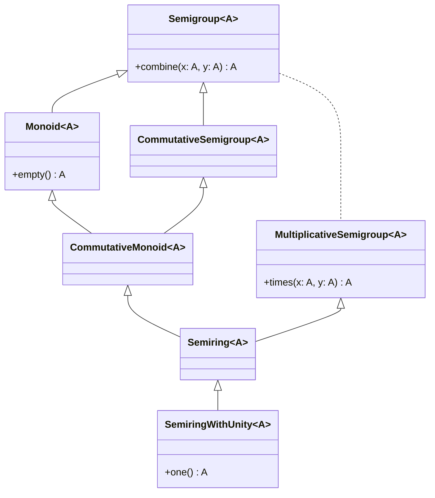



# Полукольцо с единицей

Полукольцо с единицей - это [полукольцо](semiring.md), в котором существует нейтральный элемент по умножению (называемый единицей): 
\\(\exists 1 \in S \quad \forall a \in S \quad  a \* 1 = 1 \* a = a\\).

Для полукольца с единицей должны соблюдаться все законы полукольца:

- _Замыкание сложения_ (_closure_): для \\(\forall x, y \in S\\) выполняется \\(x + y \in S\\).
- _Ассоциативность сложения_ (_associativity_): для \\(\forall x, y, z \in S\\) выполняется \\((x + y) + z = x + (y + z)\\).
- _Существование нулевого элемента_: существует \\(\exists 0 \in S\\) такой,
  что для \\(\forall x \in S\\) выполняется \\(0 + x = x + 0 = x\\)
- _Коммутативность сложения_ (_commutative_): для \\(\forall x, y \in S\\) выполняется \\(x + y = y + x\\).
- _Замыкание умножения_ (_closure_): для \\(\forall x, y \in S\\) выполняется \\(x \* y \in S\\).
- _Ассоциативность умножения_ (_associativity_): для \\(\forall x, y, z \in S\\) выполняется \\((x \* y) \* z = x \* (y \* z)\\).
- _Дистрибутивность_ (_distributivus_, _распределительный закон_):
  для \\(\forall x, y, z \in S\\) выполняется \\(x \* (y + z) = x \* y + x \* z\\) и \\((x + y) \* z = x \* z + y \* z\\).
- _Мультипликативное свойство нуля_: \\(a \* 0 = 0 \* a = 0\\)

, а также закон тождественности по умножению:

- _Существование единичного элемента_: \\(\exists 1 \in S \quad \forall x \in S \quad x \* 1 = 1 \* x = x\\)

## Код

```dotty
trait SemiringWithUnity[A] extends Semiring[A]:
  def one: A
```

### Законы

- Законы [полукольца](semiring.md)
- Проверка существования единичного элемента.
  Единичный элемент (`su.one`) — это такой элемент, который при умножении на любой другой элемент `x` не изменяет его значение. 
  Это можно выразить двумя способами:
    - Если умножить `x` на единичный элемент (`su.one`), результат будет равен `x`: `su.times(x, su.one) == x`
    - Если умножить единичный элемент (`su.one`) на `x`, результат также будет равен `x`: `su.times(su.one, x) == x`

## Схема



## Реализация в библиотеках

### [Реализация в Spire](../../libs/spire.md)

`Rig[A]` обеспечивает `+`, `zero`, `*` и `one`.
`Rig[A]` расширяет `Semiring[A]` и `MultiplicativeMonoid[A]`.

- `zero`: аддитивное тождество
- `one`: мультипликативное тождество (такой элемент, что для любого `x` из множества `x * one = x`)

```dotty
import spire.algebra.Rig
import spire.math.Rational

Rig.plus(Rational(1, 2), Rational(1, 3))
// val res0: spire.math.Rational = 5/6
Rig.times(Rational(1, 2), Rational(1, 3))
// val res1: spire.math.Rational = 1/6
Rig.pow(Rational(1, 2), 3)
// val res2: spire.math.Rational = 1/8
Rig.zero[Rational]
// val res3: spire.math.Rational = 0
Rig.one[Rational]
// val res4: spire.math.Rational = 1
```

---

**Ссылки:**

- [Ссылка на репозиторий с упражнениями][sample]
- [Spire home page](https://typelevel.org/spire/)
- [Spire User's Guide](https://typelevel.org/spire/guide.html)
- [Wikipedia](https://ru.wikipedia.org/wiki/%D0%9F%D0%BE%D0%BB%D1%83%D0%BA%D0%BE%D0%BB%D1%8C%D1%86%D0%BE)

[sample]: https://gitverse.ru/scalabook/typeclasses
