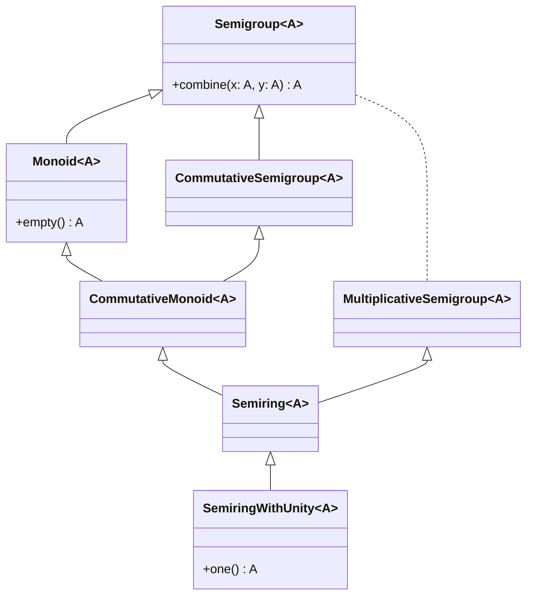

# Полукольцо с единицей

**Полукольцо с единицей** — это полукольцо, в котором существует нейтральный элемент относительно операции умножения. Этот элемент называется **единицей** и обозначается обычно как \( 1 \). Давайте разберём это подробнее.

---

### Определение полукольца с единицей
Полукольцо с единицей — это множество \( S \), на котором определены две бинарные операции:
1. **Сложение** (\( + \)): коммутативная и ассоциативная операция.
2. **Умножение** (\( \cdot \)): ассоциативная операция.

Эти операции должны удовлетворять следующим аксиомам:
1. **Коммутативность сложения**: \( a + b = b + a \) для любых \( a, b \in S \).
2. **Ассоциативность сложения**: \( (a + b) + c = a + (b + c) \) для любых \( a, b, c \in S \).
3. **Ассоциативность умножения**: \( (a \cdot b) \cdot c = a \cdot (b \cdot c) \) для любых \( a, b, c \in S \).
4. **Дистрибутивность умножения относительно сложения**:
  - \( a \cdot (b + c) = a \cdot b + a \cdot c \) (левая дистрибутивность),
  - \( (a + b) \cdot c = a \cdot c + b \cdot c \) (правая дистрибутивность).
5. **Наличие нулевого элемента**: существует элемент \( 0 \in S \) такой, что \( a + 0 = a \) и \( a \cdot 0 = 0 \cdot a = 0 \) для любого \( a \in S \).
6. **Наличие единичного элемента**: существует элемент \( 1 \in S \) такой, что \( a \cdot 1 = 1 \cdot a = a \) для любого \( a \in S \).

Таким образом, полукольцо с единицей — это полукольцо, в котором есть нейтральный элемент относительно умножения.

---

### Примеры полуколец с единицей
1. **Множество натуральных чисел \( \mathbb{N} \) с обычными сложением и умножением**:
  - Сложение и умножение ассоциативны и коммутативны.
  - Нулевой элемент: \( 0 \).
  - Единичный элемент: \( 1 \).
  - Дистрибутивность выполняется.

2. **Множество неотрицательных действительных чисел \( \mathbb{R}_{\geq 0} \) с обычными сложением и умножением**:
  - Сложение и умножение ассоциативны и коммутативны.
  - Нулевой элемент: \( 0 \).
  - Единичный элемент: \( 1 \).
  - Дистрибутивность выполняется.

3. **Булево полукольцо**:
  - Множество: \( \{0, 1\} \).
  - Операции: логическое ИЛИ (\( + \)) и логическое И (\( \cdot \)).
  - Нулевой элемент: \( 0 \).
  - Единичный элемент: \( 1 \).
  - Дистрибутивность выполняется.

4. **Полукольцо квадратных матриц фиксированного размера**:
  - Множество: квадратные матрицы размера \( n \times n \) с неотрицательными элементами.
  - Операции: сложение и умножение матриц.
  - Нулевой элемент: нулевая матрица.
  - Единичный элемент: единичная матрица.
  - Дистрибутивность выполняется.

5. **Тропическое полукольцо с единицей**:
  - Множество: \( \mathbb{R} \cup \{+\infty\} \).
  - Операции: минимум (\( + \)) и сложение (\( \cdot \)).
  - Нулевой элемент: \( +\infty \).
  - Единичный элемент: \( 0 \) (поскольку \( a + 0 = a \) и \( a \cdot 0 = a \) в тропической арифметике).
  - Дистрибутивность выполняется.

---

### Зачем нужны полукольца с единицей?
Полукольца с единицей находят применение в различных областях:
1. **Теория автоматов и формальных языков**: используются для описания и анализа регулярных выражений.
2. **Оптимизация**: тропическое полукольцо применяется в задачах оптимизации, таких как поиск кратчайших путей в графах.
3. **Компьютерные науки**: используются в алгоритмах, связанных с графами, сетями и логическими операциями.
4. **Алгебра**: изучаются как обобщение колец и полей.

---

### Отличие полукольца с единицей от полукольца без единицы
Основное отличие заключается в наличии единичного элемента относительно умножения. В полукольце с единицей существует элемент \( 1 \), который является нейтральным для умножения, то есть \( a \cdot 1 = 1 \cdot a = a \) для любого \( a \in S \). В полукольце без единицы такого элемента может не быть.

---

### Итог
Полукольцо с единицей — это полукольцо, в котором существует нейтральный элемент относительно умножения. Оно широко используется в математике, информатике и других науках для моделирования и анализа различных систем.

## Формальное определение

Полукольцо с единицей - это [полукольцо](semiring.md), в котором существует нейтральный элемент по умножению (называемый единицей): 
\\(\exists 1 \in S \quad \forall a \in S \quad  a \* 1 = 1 \* a = a\\).

Для полукольца с единицей должны соблюдаться все законы полукольца:

- _Замыкание сложения_ (_closure_): для \\(\forall x, y \in S\\) выполняется \\(x + y \in S\\).
- _Ассоциативность сложения_ (_associativity_): для \\(\forall x, y, z \in S\\) выполняется \\((x + y) + z = x + (y + z)\\).
- _Существование нулевого элемента_: существует \\(\exists 0 \in S\\) такой,
  что для \\(\forall x \in S\\) выполняется \\(0 + x = x + 0 = x\\)
- _Коммутативность сложения_ (_commutative_): для \\(\forall x, y \in S\\) выполняется \\(x + y = y + x\\).
- _Замыкание умножения_ (_closure_): для \\(\forall x, y \in S\\) выполняется \\(x \* y \in S\\).
- _Ассоциативность умножения_ (_associativity_): для \\(\forall x, y, z \in S\\) выполняется \\((x \* y) \* z = x \* (y \* z)\\).
- _Дистрибутивность_ (_distributivus_, _распределительный закон_):
  для \\(\forall x, y, z \in S\\) выполняется \\(x \* (y + z) = x \* y + x \* z\\) и \\((x + y) \* z = x \* z + y \* z\\).
- _Мультипликативное свойство нуля_: \\(a \* 0 = 0 \* a = 0\\)

, а также закон тождественности по умножению:

- _Существование единичного элемента_: \\(\exists 1 \in S \quad \forall x \in S \quad x \* 1 = 1 \* x = x\\)

## Код

```dotty
trait SemiringWithUnity[A] extends Semiring[A]:
  def one: A
```

### Числа относительно сложения с 0 и умножения с 1

`(Z, +, *)`

```dotty
given SemiringWithUnity[Int] with
  val empty: Int                   = 0
  val one: Int                     = 1
  def combine(x: Int, y: Int): Int = x + y
  def times(x: Int, y: Int): Int   = x * y
```

### Законы

```dotty
trait SemiringWithUnityLaw extends SemiringLaw:
  def checkSemiringWithUnityLaw[A: SemiringWithUnity](
      x: A,
      y: A,
      z: A
  ): ValidatedNel[String, Unit] =
    checkSemiringLaw(x, y, z) combine
      check(
        SemiringWithUnity[A].times(x, SemiringWithUnity[A].one) == x,
        "times right identity: x * 1 = x"
      ) combine
      check(
        SemiringWithUnity[A].times(SemiringWithUnity[A].one, x) == x,
        "times left identity: 1 * x = x"
      )
```

## Схема



## Реализация в библиотеках

### Реализация в Spire

```dotty
import spire.algebra.Rig
import spire.math.Rational

Rig.plus(Rational(1, 2), Rational(1, 3))
// val res0: spire.math.Rational = 5/6
Rig.times(Rational(1, 2), Rational(1, 3))
// val res1: spire.math.Rational = 1/6
Rig.pow(Rational(1, 2), 3)
// val res2: spire.math.Rational = 1/8
Rig.zero[Rational]
// val res3: spire.math.Rational = 0
Rig.one[Rational]
// val res4: spire.math.Rational = 1
```

---

**Ссылки:**

- [Spire home page](https://typelevel.org/spire)
- [Spire User's Guide](https://typelevel.org/spire/guide.html)
- [Wikipedia](https://ru.wikipedia.org/wiki/%D0%9F%D0%BE%D0%BB%D1%83%D0%BA%D0%BE%D0%BB%D1%8C%D1%86%D0%BE)
