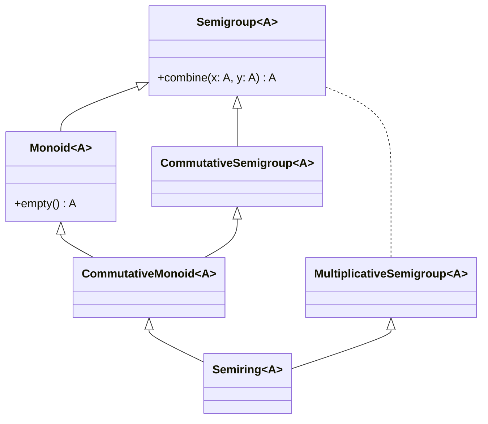

# Полукольцо

**Полукольцо** — это алгебраическая структура, которая обобщает понятие [кольца](ring.md), ослабляя некоторые из его свойств. 
Полукольцо обладает двумя операциями (обычно называемыми сложением и умножением), 
которые удовлетворяют определённым аксиомам, но при этом не требуется, чтобы сложение было обратимым 
(то есть не требуется существование обратных элементов относительно сложения).

**Определение полукольца**

Полукольцо — это множество \\(S\\), на котором определены две бинарные операции:

- **Сложение** (\\(+\\)): коммутативная и ассоциативная операция.
- **Умножение** (\\(\cdot\\)): ассоциативная операция.

Эти операции должны удовлетворять следующим аксиомам:

- **Коммутативность сложения**: \\(a + b = b + a\\) для любых \\(a, b \in S\\).
- **Ассоциативность сложения**: \\((a + b) + c = a + (b + c)\\) для любых \\(a, b, c \in S\\).
- **Ассоциативность умножения**: \\((a \cdot b) \cdot c = a \cdot (b \cdot c)\\) для любых \\(a, b, c \in S\\).
- **Дистрибутивность умножения относительно сложения**:
    - \\(a \cdot (b + c) = a \cdot b + a \cdot c\\) (левая дистрибутивность),
    - \\((a + b) \cdot c = a \cdot c + b \cdot c\\) (правая дистрибутивность).
- **Наличие нулевого элемента**: существует элемент \\(0 \in S\\) такой, 
  что \\(0 + a = a + 0 = a\\) и \\(a \cdot 0 = 0 \cdot a = 0\\) для любого \\(a \in S\\).

**Примеры полуколец**

- **Множество натуральных чисел \\(\mathbb{N}\\) с обычными сложением и умножением**:
    - Сложение и умножение ассоциативны и коммутативны.
    - Нулевой элемент: \\(0\\).
    - Дистрибутивность выполняется.
    - Обратных элементов по сложению нет (например, для \\(1\\) нет такого \\(x\\), что \\(1 + x = 0\\)).
- **Множество неотрицательных действительных чисел \\(\mathbb{R}_{\geq 0}\\) с обычными сложением и умножением**:
    - Сложение и умножение ассоциативны и коммутативны.
    - Нулевой элемент: \\(0\\).
    - Дистрибутивность выполняется.
    - Обратных элементов по сложению нет.
- **Булево полукольцо**:
    - Множество: \\(\{0, 1\}\\).
    - Операции: логическое ИЛИ (\\(+\\)) и логическое И (\\(\cdot\\)).
    - Нулевой элемент: \\(0\\).
    - Дистрибутивность выполняется.
- **Полукольцо подмножеств**:
    - Множество: все подмножества некоторого множества \\(X\\).
    - Операции: объединение (\\(+\\)) и пересечение (\\(\cdot\\)).
    - Нулевой элемент: пустое множество \\(\emptyset\\).
    - Дистрибутивность выполняется.
- [**Тропическое полукольцо**](https://ru.wikipedia.org/wiki/%D0%A2%D1%80%D0%BE%D0%BF%D0%B8%D1%87%D0%B5%D1%81%D0%BA%D0%B0%D1%8F_%D0%B3%D0%B5%D0%BE%D0%BC%D0%B5%D1%82%D1%80%D0%B8%D1%8F):
    - Множество: \\(\mathbb{R} \cup \{+\infty\}\\).
    - Операции: минимум (\\(+\\)) и сложение (\\(\cdot\\)).
    - Нулевой элемент: \\(+\infty\\).
    - Дистрибутивность выполняется.

**Зачем нужны полукольца?**

Полукольца находят применение в различных областях:

- **Теория автоматов и формальных языков**: используются для описания и анализа регулярных выражений.
- **Оптимизация**: тропическое полукольцо применяется в задачах оптимизации, таких как поиск кратчайших путей в графах.
- **Компьютерные науки**: используются в алгоритмах, связанных с графами, сетями и логическими операциями.
- **Алгебра**: изучаются как обобщение колец и полей.

## Формальное определение

В то время как [группа](group.md), [моноид](monoid.md) и [полугруппа](semigroup.md) 
определяются множеством и одной операцией, полукольцо определяется множеством и двумя операциями. 
Учитывая множество `R` и операции `+` и `*`, 
мы говорим, что `(R, +, *)` - это полукольцо, если оно удовлетворяет следующим свойствам:

- `(R, +)` является [коммутативным моноидом](cmonoid.md)
- `(R, *)` является [полугруппой](semigroup.md)

Для полугруппы должны соблюдаться законы коммутативного моноида по сложению:

- _Замыкание_ (_closure_): для \\(\forall x, y \in S\\) выполняется \\(x + y \in S\\).
- _Ассоциативность_ (_associativity_): для \\(\forall x, y, z \in S\\) выполняется \\((x + y) + z = x + (y + z)\\).
- _Тождественность_ или _существования нейтрального элемента_ (_identity_): существует \\(\exists e \in S\\) такой,
  что для \\(\forall x \in S\\) выполняется \\(e + x = x + e = x\\)
- _Коммутативность_ (_commutative_): для \\(\forall x, y \in S\\) выполняется \\(x + y = y + x\\).

и законы полугруппы по умножению:

- _Замыкание_ (_closure_): для \\(\forall x, y \in S\\) выполняется \\(x \* y \in S\\).
- _Ассоциативность_ (_associativity_): для \\(\forall x, y, z \in S\\) выполняется \\((x \* y) \* z = x \* (y \* z)\\).

, а также дистрибутивность и мультипликативное свойство нуля:

- _Дистрибутивность_ (_distributivus_, _распределительный закон_):
  для \\(\forall x, y, z \in S\\) выполняется \\(x \* (y + z) = x \* y + x \* z\\) и \\((x + y) \* z = x \* z + y \* z\\).
- _Мультипликативное свойство нуля_: \\(a \* 0 = 0 \* a = 0\\)

### Связь с кольцом

Полукольцо — общеалгебраическая структура, похожая на [кольцо](ring.md), 
но без требования существования противоположного по сложению элемента.
В кольце же для каждого элемента \\(a\\) должен существовать элемент \\(-a\\) такой, что \\(a + (-a) = 0\\).

Для [кольца](ring.md) последнее соотношение (_мультипликативное свойство нуля_) не требуется, 
поскольку оно следует из других, для полукольца оно необходимо.
Отличие полукольца от кольца состоит только в том, что по сложению полукольцо образует не коммутативную группу,
а только коммутативный моноид.

## Код

```dotty
trait MultiplicativeSemigroup[A]:
  def times(x: A, y: A): A

trait Semiring[A] extends CMonoid[A], MultiplicativeSemigroup[A]    
```

### Числа относительно сложения с 0 и умножения

`(Z, +, *)`

```dotty
given Semiring[Int] with
  val empty                        = 0
  def combine(x: Int, y: Int): Int = x + y
  def times(x: Int, y: Int): Int   = x * y
```

### Законы

- Замыкание следует из определения функции `combine`: тип результата этой функции совпадает с типом переменных,
  которые она принимает.
- Ассоциативность выражается следующим образом:
  `sr.combine(x, sr.combine(y, z))` должно быть равно `sr.combine(sr.combine(x, y), z)`.  
  Это означает, что порядок объединения элементов не влияет на итоговый результат.
- Тождественность означает, что если вы объединяете любой элемент `x` с нейтральным элементом (`sr.empty`),
  то результат всегда будет равен `x`. Другими словами, нейтральный элемент не меняет значение `x` при объединении.
  Это можно записать так:
    - `sr.combine(x, sr.empty) == x`
    - `sr.combine(sr.empty, x) == x`
- Коммутативность означает, что порядок элементов при объединении не важен.
  Другими словами, результат операции `combine` будет одинаковым, независимо от того,
  в каком порядке вы передаёте элементы `x` и `y`.
  Это можно записать так: `sr.combine(x, y) == sr.combine(y, x)`
- Ассоциативность по умножению выражается следующим образом:
  `sr.times(x, sr.times(y, z))` должно быть равно `sr.times(sr.times(x, y), z)`.  
  Это означает, что порядок перемножения элементов не влияет на итоговый результат.
- Дистрибутивность означает, что операция умножения (`times`) распределяется относительно операции сложения (`combine`). 
  Это можно выразить двумя способами:
    - Если вы умножаете результат сложения `(x + y)` на `z`, это то же самое, что сложить результаты умножения `x` на `z` и `y` на `z`:
      `sr.times(sr.combine(x, y), z) == sr.combine(sr.times(x, z), sr.times(y, z))`
    - Если вы умножаете `x` на результат сложения `(y + z)`, это то же самое, что сложить результаты умножения `x` на `y` и `x` на `z`:
      `sr.times(x, sr.combine(y, z)) == sr.combine(sr.times(x, y), sr.times(x, z))`
- Мультипликативное свойство связано с нейтральным элементом (`sr.empty`). 
  Оно означает, что умножение любого элемента на нейтральный элемент всегда даёт нейтральный элемент:
    - Если вы умножаете нейтральный элемент (`sr.empty`) на `x`, результат будет нейтральным элементом:
      `sr.times(sr.empty, x) == sr.empty`
    - Если вы умножаете `x` на нейтральный элемент (`sr.empty`), результат также будет нейтральным элементом:
      `sr.times(x, sr.empty) == sr.empty`

```dotty
... // Законы коммутативного моноида

def checkMultiplicativeAssociativity[A](x: A, y: A, z: A)(using
    ms: MultiplicativeSemigroup[A]
): ValidatedNel[String, Unit] =
  Either.cond[String, Unit](
    ms.times(ms.times(x, y), z) == ms.times(x, ms.times(y, z)),
    (),
    "Не соблюдается ассоциативность по умножению: (x * y) * z должно быть равно x * (y * z)"
  ).toValidatedNel
  
def checkRightDistributivity[A](x: A, y: A, z: A)(using
    sr: Semiring[A]
): ValidatedNel[String, Unit] =
  Either.cond[String, Unit](
    sr.times(sr.combine(x, y), z) == sr.combine(
      sr.times(x, z),
      sr.times(y, z)
    ),
    (),
    "Не соблюдается дистрибутивность справа: (x + y) * z = x * z + y * z"
  ).toValidatedNel

def checkLeftDistributivity[A](x: A, y: A, z: A)(using
    sr: Semiring[A]
): ValidatedNel[String, Unit] =
  Either.cond[String, Unit](
    sr.times(x, sr.combine(y, z)) == sr.combine(
      sr.times(x, y),
      sr.times(x, z)
    ),
    (),
    "Не соблюдается дистрибутивность слева: x * (y + z) = x * y + x * z"
  ).toValidatedNel
    
def checkRightMultiplicativePropertyOfZero[A](x: A)(using
    sr: Semiring[A]
): ValidatedNel[String, Unit] =
  Either.cond[String, Unit](
    sr.times(sr.empty, x) == sr.empty,
    (),
    "Не соблюдается мультипликативное свойство нуля справа: 0 * a = 0"
  ).toValidatedNel

def checkLeftMultiplicativePropertyOfZero[A](x: A)(using
    sr: Semiring[A]
): ValidatedNel[String, Unit] =
  Either.cond[String, Unit](
    sr.times(x, sr.empty) == sr.empty,
    (),
    "Не соблюдается мультипликативное свойство нуля слева: a * 0 = 0"
  ).toValidatedNel      
```

## Схема



## Реализация в библиотеках

### Реализация в Spire

```dotty
import spire.algebra.Semiring
import spire.math.Rational

Semiring.plus(Rational(1, 2), Rational(1, 3))
// val res0: spire.math.Rational = 5/6
Semiring.times(Rational(1, 2), Rational(1, 3))
// val res1: spire.math.Rational = 1/6
Semiring.pow(Rational(1, 2), 3)
// val res2: spire.math.Rational = 1/8
```

---

**Ссылки:**

- [A tale on Semirings](https://typelevel.org/blog/2018/11/02/semirings.html)
- [Spire home page](https://typelevel.org/spire)
- [Spire User's Guide](https://typelevel.org/spire/guide.html)
- [Wikipedia](https://ru.wikipedia.org/wiki/%D0%9F%D0%BE%D0%BB%D1%83%D0%BA%D0%BE%D0%BB%D1%8C%D1%86%D0%BE)
