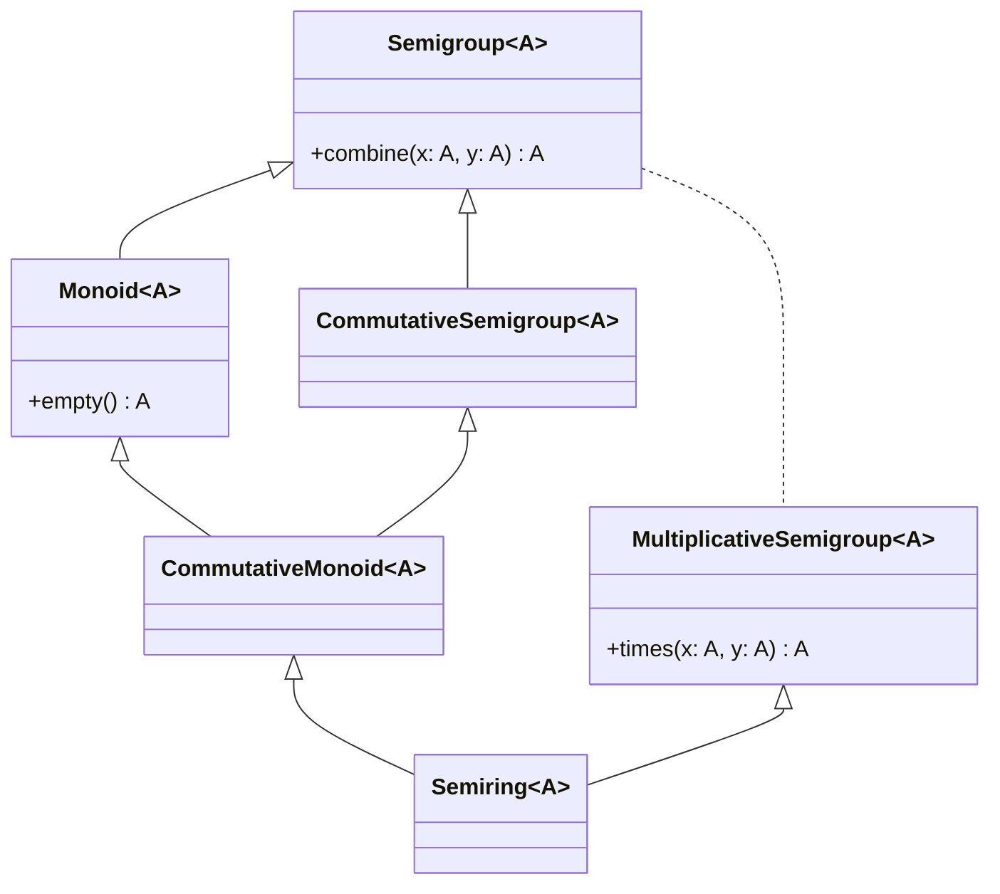



# Полукольцо

В то время как [группа](group.md), [моноид](monoid.md) и [полугруппа](semigroup.md) 
определяются множеством и одной операцией, полукольцо определяется множеством и двумя операциями. 
Учитывая множество `R` и операции `+` и `*`, 
мы говорим, что `(R, +, *)` - это полукольцо, если оно удовлетворяет следующим свойствам:

- `(R, +)` является [коммутативным моноидом](cmonoid.md)
- `(R, *)` является [полугруппой](semigroup.md)

Для полукольца должны соблюдаться законы коммутативного моноида по сложению:

- _Замыкание_ (_closure_): для \\(\forall x, y \in S\\) выполняется \\(x + y \in S\\).
- _Ассоциативность_ (_associativity_): для \\(\forall x, y, z \in S\\) выполняется \\((x + y) + z = x + (y + z)\\).
- _Тождественность_ или _существования нейтрального элемента_ (_identity_): существует \\(\exists e \in S\\) такой,
  что для \\(\forall x \in S\\) выполняется \\(e + x = x + e = x\\)
- _Коммутативность_ (_commutative_): для \\(\forall x, y \in S\\) выполняется \\(x + y = y + x\\).

и законы полугруппы по умножению:

- _Замыкание_ (_closure_): для \\(\forall x, y \in S\\) выполняется \\(x \* y \in S\\).
- _Ассоциативность_ (_associativity_): для \\(\forall x, y, z \in S\\) выполняется \\((x \* y) \* z = x \* (y \* z)\\).

, а также дистрибутивность и мультипликативное свойство нуля:

- _Дистрибутивность_ (_distributivus_, _распределительный закон_):
  для \\(\forall x, y, z \in S\\) выполняется \\(x \* (y + z) = x \* y + x \* z\\) и \\((x + y) \* z = x \* z + y \* z\\).
- _Мультипликативное свойство нуля_: \\(a \* 0 = 0 \* a = 0\\)

## Код

```dotty
trait MultiplicativeSemigroup[A]:
  def times(x: A, y: A): A

trait Semiring[A] extends CMonoid[A], MultiplicativeSemigroup[A]    
```

### Законы

- Замыкание следует из определения функции `combine`: тип результата этой функции совпадает с типом переменных,
  которые она принимает.
- Ассоциативность выражается следующим образом:
  `sr.combine(x, sr.combine(y, z))` должно быть равно `sr.combine(sr.combine(x, y), z)`.  
  Это означает, что порядок объединения элементов не влияет на итоговый результат.
- Тождественность означает, что если вы объединяете любой элемент `x` с нейтральным элементом (`sr.empty`),
  то результат всегда будет равен `x`. Другими словами, нейтральный элемент не меняет значение `x` при объединении.
  Это можно записать так:
    - `sr.combine(x, sr.empty) == x`
    - `sr.combine(sr.empty, x) == x`
- Коммутативность означает, что порядок элементов при объединении не важен.
  Другими словами, результат операции `combine` будет одинаковым, независимо от того,
  в каком порядке вы передаёте элементы `x` и `y`.
  Это можно записать так: `sr.combine(x, y) == sr.combine(y, x)`
- Ассоциативность по умножению выражается следующим образом:
  `sr.times(x, sr.times(y, z))` должно быть равно `sr.times(sr.times(x, y), z)`.  
  Это означает, что порядок перемножения элементов не влияет на итоговый результат.
- Дистрибутивность означает, что операция умножения (`times`) распределяется относительно операции сложения (`combine`). 
  Это можно выразить двумя способами:
    - Если вы умножаете результат сложения `(x + y)` на `z`, это то же самое, что сложить результаты умножения `x` на `z` и `y` на `z`:
      `sr.times(sr.combine(x, y), z) == sr.combine(sr.times(x, z), sr.times(y, z))`
    - Если вы умножаете `x` на результат сложения `(y + z)`, это то же самое, что сложить результаты умножения `x` на `y` и `x` на `z`:
      `sr.times(x, sr.combine(y, z)) == sr.combine(sr.times(x, y), sr.times(x, z))`
- Мультипликативное свойство связано с нейтральным элементом (`sr.empty`). 
  Оно означает, что умножение любого элемента на нейтральный элемент всегда даёт нейтральный элемент:
    - Если вы умножаете нейтральный элемент (`sr.empty`) на `x`, результат будет нейтральным элементом:
      `sr.times(sr.empty, x) == sr.empty`
    - Если вы умножаете `x` на нейтральный элемент (`sr.empty`), результат также будет нейтральным элементом:
      `sr.times(x, sr.empty) == sr.empty`

## Упражнения

### Упражнение 1.5.1: Реализация полукольца для целых чисел.

> [Репозиторий с упражнениями и инструкцией по выполнению][sample]

Заполните пропущенные части (`???`):

```dotty
given Semiring[Int] with
  val empty: Int = ???
  
  def combine(x: Int, y: Int): Int = 
    ???
    
  def times(x: Int, y: Int): Int = 
    ???
```

@:note(🔍 Показать решение)

```dotty
given Semiring[Int] with
  val empty: Int = 0
  
  def combine(x: Int, y: Int): Int = 
    x + y
    
  def times(x: Int, y: Int): Int = 
    x * y 
```

**Примеры вызовов**:

```dotty
Semiring[Int].combine(5, 3)
// 8
Semiring[Int].empty
// 0
Semiring[Int].times(5, 3)
// 15
```

@:@

## Схема



## Реализация в библиотеках

### Реализация в Spire

```dotty
import spire.algebra.Semiring
import spire.math.Rational

Semiring.plus(Rational(1, 2), Rational(1, 3))
// val res0: spire.math.Rational = 5/6
Semiring.times(Rational(1, 2), Rational(1, 3))
// val res1: spire.math.Rational = 1/6
Semiring.pow(Rational(1, 2), 3)
// val res2: spire.math.Rational = 1/8
```

---

**Ссылки:**

- [Ссылка на репозиторий с упражнениями][sample]
- [A tale on Semirings](https://typelevel.org/blog/2018/11/02/semirings.html)
- [Spire home page](https://typelevel.org/spire/)
- [Spire User's Guide](https://typelevel.org/spire/guide.html)
- [Wikipedia](https://ru.wikipedia.org/wiki/%D0%9F%D0%BE%D0%BB%D1%83%D0%BA%D0%BE%D0%BB%D1%8C%D1%86%D0%BE)

[sample]: https://gitverse.ru/scalabook/typeclasses
