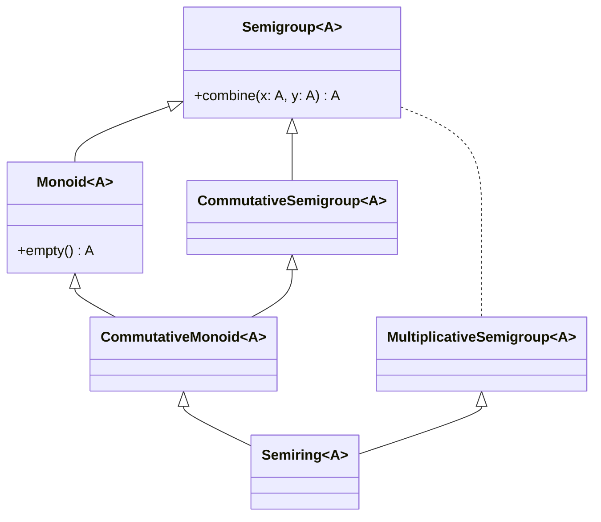

# Полукольцо

**Полукольцо** — это алгебраическая структура, которая обобщает понятие кольца, ослабляя некоторые из его свойств. Полукольцо обладает двумя операциями (обычно называемыми сложением и умножением), которые удовлетворяют определённым аксиомам, но при этом не требуется, чтобы сложение было обратимым (то есть не требуется существование обратных элементов относительно сложения). Давайте разберём это подробнее.

---

### Определение полукольца
Полукольцо — это множество \\(S\\), на котором определены две бинарные операции:
1. **Сложение** (\\(+\\)): коммутативная и ассоциативная операция.
2. **Умножение** (\\(\cdot\\)): ассоциативная операция.

Эти операции должны удовлетворять следующим аксиомам:
1. **Коммутативность сложения**: \\(a + b = b + a\\) для любых \\(a, b \in S\\).
2. **Ассоциативность сложения**: \\((a + b) + c = a + (b + c)\\) для любых \\(a, b, c \in S\\).
3. **Ассоциативность умножения**: \\((a \cdot b) \cdot c = a \cdot (b \cdot c)\\) для любых \\(a, b, c \in S\\).
4. **Дистрибутивность умножения относительно сложения**:
  - \\(a \cdot (b + c) = a \cdot b + a \cdot c\\) (левая дистрибутивность),
  - \\((a + b) \cdot c = a \cdot c + b \cdot c\\) (правая дистрибутивность).
5. **Наличие нулевого элемента**: существует элемент \\(0 \in S\\) такой, что \\(a + 0 = a\\) и \\(a \cdot 0 = 0 \cdot a = 0\\) для любого \\(a \in S\\).

Обратите внимание, что в полукольце **не требуется** существование обратных элементов относительно сложения (то есть полукольцо не обязательно является группой по сложению).

---

### Примеры полуколец
1. **Множество натуральных чисел \\(\mathbb{N}\\) с обычными сложением и умножением**:
  - Сложение и умножение ассоциативны и коммутативны.
  - Нулевой элемент: \\(0\\).
  - Дистрибутивность выполняется.
  - Обратных элементов по сложению нет (например, для \\(1\\) нет такого \\(x\\), что \\(1 + x = 0\\)).

2. **Множество неотрицательных действительных чисел \\(\mathbb{R}_{\geq 0}\\) с обычными сложением и умножением**:
  - Сложение и умножение ассоциативны и коммутативны.
  - Нулевой элемент: \\(0\\).
  - Дистрибутивность выполняется.
  - Обратных элементов по сложению нет.

3. **Булево полукольцо**:
  - Множество: \\(\{0, 1\}\\).
  - Операции: логическое ИЛИ (\\(+\\)) и логическое И (\\(\cdot\\)).
  - Нулевой элемент: \\(0\\).
  - Дистрибутивность выполняется.

4. **Полукольцо подмножеств**:
  - Множество: все подмножества некоторого множества \\(X\\).
  - Операции: объединение (\\(+\\)) и пересечение (\\(\cdot\\)).
  - Нулевой элемент: пустое множество \\(\emptyset\\).
  - Дистрибутивность выполняется.

5. **Тропическое полукольцо**:
  - Множество: \\(\mathbb{R} \cup \{+\infty\}\\).
  - Операции: минимум (\\(+\\)) и сложение (\\(\cdot\\)).
  - Нулевой элемент: \\(+\infty\\).
  - Дистрибутивность выполняется.

---

### Зачем нужны полукольца?
Полукольца находят применение в различных областях:
1. **Теория автоматов и формальных языков**: используются для описания и анализа регулярных выражений.
2. **Оптимизация**: тропическое полукольцо применяется в задачах оптимизации, таких как поиск кратчайших путей в графах.
3. **Компьютерные науки**: используются в алгоритмах, связанных с графами, сетями и логическими операциями.
4. **Алгебра**: изучаются как обобщение колец и полей.

---

### Отличие полукольца от кольца
Основное отличие полукольца от кольца заключается в том, что в полукольце **не требуется** существование обратных элементов относительно сложения. В кольце же для каждого элемента \\(a\\) должен существовать элемент \\(-a\\) такой, что \\(a + (-a) = 0\\). Таким образом, полукольцо — это более общая структура, чем кольцо.

---

### Итог
Полукольцо — это алгебраическая структура с двумя операциями (сложением и умножением), которая обобщает понятие кольца, но не требует обратимости сложения. Оно широко используется в математике, информатике и других науках для моделирования и анализа различных систем.

## Формальное определение

В то время как [группа](group.md), [моноид](monoid.md) и [полугруппа](semigroup.md) 
определяются множеством и одной операцией, полукольцо определяется множеством и двумя операциями. 
Учитывая множество `R` и операции `+` и `*`, 
мы говорим, что `(R, +, *)` - это полукольцо, если оно удовлетворяет следующим свойствам:

- `(R, +)` является [коммутативным моноидом](cmonoid.md)
- `(R, *)` является [полугруппой](semigroup.md)

Для полугруппы должны соблюдаться законы коммутативного моноида по сложению:

- _Замыкание_ (_closure_): для \\(\forall x, y \in S\\) выполняется \\(x + y \in S\\).
- _Ассоциативность_ (_associativity_): для \\(\forall x, y, z \in S\\) выполняется \\((x + y) + z = x + (y + z)\\).
- _Тождественность_ или _существования нейтрального элемента_ (_identity_): существует \\(\exists e \in S\\) такой,
  что для \\(\forall x \in S\\) выполняется \\(e + x = x + e = x\\)
- _Коммутативность_ (_commutative_): для \\(\forall x, y \in S\\) выполняется \\(x + y = y + x\\).

и законы полугруппы по умножению:

- _Замыкание_ (_closure_): для \\(\forall x, y \in S\\) выполняется \\(x \* y \in S\\).
- _Ассоциативность_ (_associativity_): для \\(\forall x, y, z \in S\\) выполняется \\((x \* y) \* z = x \* (y \* z)\\).

, а также дистрибутивность и мультипликативное свойство нуля:

- _Дистрибутивность_ (_distributivus_, _распределительный закон_):
  для \\(\forall x, y, z \in S\\) выполняется \\(x \* (y + z) = x \* y + x \* z\\) и \\((x + y) \* z = x \* z + y \* z\\).
- _Мультипликативное свойство нуля_: \\(a \* 0 = 0 \* a = 0\\)

### Связь с кольцом

Полукольцо — общеалгебраическая структура, похожая на [кольцо](ring.md), 
но без требования существования противоположного по сложению элемента.

Для [кольца](ring.md) последнее соотношение (_мультипликативное свойство нуля_) не требуется, 
поскольку оно следует из других, для полукольца оно необходимо.
Отличие полукольца от кольца состоит только в том, что по сложению полукольцо образует не коммутативную группу,
а только коммутативный моноид.

## Код

```dotty
trait MultiplicativeSemigroup[A]:
  def times(x: A, y: A): A

trait Semiring[A] extends CMonoid[A], MultiplicativeSemigroup[A]    
```

### Числа относительно сложения с 0 и умножения

`(Z, +, *)`

```dotty
given Semiring[Int] with
  val empty                        = 0
  def combine(x: Int, y: Int): Int = x + y
  def times(x: Int, y: Int): Int   = x * y
```

### Законы

```dotty
trait MultiplicativeSemigroupLaw extends Laws:
  def checkMultiplicativeSemigroupLaw[A: MultiplicativeSemigroup](
      x: A,
      y: A,
      z: A
  ): ValidatedNel[String, Unit] =
    check(
      MultiplicativeSemigroup[A]
        .times(MultiplicativeSemigroup[A].times(x, y), z) ==
        MultiplicativeSemigroup[A]
          .times(x, MultiplicativeSemigroup[A].times(y, z)),
      "associative: (x * y) * z == x * (y * z)"
    )
    
trait SemiringLaw extends CMonoidLaw, MultiplicativeSemigroupLaw:
  def checkSemiringLaw[A: Semiring](
      x: A,
      y: A,
      z: A
  ): ValidatedNel[String, Unit] =
    checkCMonoidLaw(x, y, z) combine
      checkMultiplicativeSemigroupLaw(x, y, z) combine
      check(
        Semiring[A].times(x, Semiring[A].combine(y, z)) ==
          Semiring[A].combine(Semiring[A].times(x, y), Semiring[A].times(x, z)),
        "left distributivus: x * (y + z) = x * y + x * z"
      ) combine
      check(
        Semiring[A].times(Semiring[A].combine(x, y), z) ==
          Semiring[A].combine(Semiring[A].times(x, z), Semiring[A].times(y, z)),
        "right distributivus: (x + y) * z = x * z + y * z"
      ) combine
      check(
        Semiring[A].times(x, Semiring[A].empty) == Semiring[A].empty,
        "left zero multiplicative: a * 0 = 0"
      ) combine
      check(
        Semiring[A].times(Semiring[A].empty, x) == Semiring[A].empty,
        "right zero multiplicative: 0 * a = 0"
      )  
```

## Схема



## Реализация в библиотеках

### Реализация в Spire

```dotty
import spire.algebra.Semiring
import spire.math.Rational

Semiring.plus(Rational(1, 2), Rational(1, 3))
// val res0: spire.math.Rational = 5/6
Semiring.times(Rational(1, 2), Rational(1, 3))
// val res1: spire.math.Rational = 1/6
Semiring.pow(Rational(1, 2), 3)
// val res2: spire.math.Rational = 1/8
```

---

**Ссылки:**

- [A tale on Semirings](https://typelevel.org/blog/2018/11/02/semirings.html)
- [Spire home page](https://typelevel.org/spire)
- [Spire User's Guide](https://typelevel.org/spire/guide.html)
- [Wikipedia](https://ru.wikipedia.org/wiki/%D0%9F%D0%BE%D0%BB%D1%83%D0%BA%D0%BE%D0%BB%D1%8C%D1%86%D0%BE)
